# FleetX — Intelligent Fleet & Logistics Management System
## System Architecture & Technical Design

**Document Reference:** FLEETX-ARCH-2026-V1.0  
**Academic Year:** 2026–27  
**Baseline Date:** 10 October 2026  
**Architect:** Student 1 (Team Leader & Architect)  
**Status:** Approved Architectural Baseline (Phase 0)

---

## 1. Architectural Style & Decision Record (ADR)

### 1.1 Architectural Pattern: Modular Monolith
FleetX is architected as a **Modular Monolith** rather than distributed microservices.

```
┌─────────────────────────────────────────────────────────────────────────────┐
│                       MODULAR MONOLITH BOUNDARIES                           │
│                                                                             │
│   ┌─────────────────────────────────────────────────────────────────────┐   │
│   │                        com.fleetx.common                            │   │
│   │  • Immutable Shared DTOs      • Security & Session Infrastructure   │   │
│   │  • Cross-Module Interfaces    • Global Exception Envelope           │   │
│   └───────────────▲──────────────────▲───────────────────▲──────────────┘   │
│                   │                  │                   │                  │
│       ┌───────────┴───────┐   ┌──────┴────────────┐   ┌──┴────────────┐     │
│       │com.fleetx.identity│   │ com.fleetx.fleet  │   │com.fleetx.trip│     │
│       │(Module 1: Admin)  │   │ (Module 2: Assets)│   │(Module 3: Ops)│     │
│       └───────────────────┘   └───────────────────┘   └───────────────┘     │
│                   ▲                  ▲                   ▲                  │
│                   │                  │                   │                  │
│       ┌───────────┴─────────┐        │        ┌──────────┴────────────┐     │
│       │ com.fleetx.shipment │────────┼────────│ com.fleetx.tracking   │     │
│       │ (Module 4: Cargo)   │        │        │ (Module 5: Telemetry) │     │
│       └─────────────────────┘        │        └───────────────────────┘     │
│                                      │                                      │
└──────────────────────────────────────┼──────────────────────────────────────┘
                                       │
                                       ▼
                       Single Relational Store: MySQL 8.4 LTS
```

### 1.2 Architectural Decision Record: Monolith vs Microservices
* **Decision:** Build a single deployable Spring Boot application with strictly isolated domain packages and shared service contracts.
* **Context:** A five-student undergraduate team with an academic delivery deadline cannot justify the operational overhead of Docker container orchestrators, distributed tracing, network partition handling, service discovery (Eureka/Consul), distributed transactions (Saga), and distributed logging.
* **Consequences:** 
  - Developers run the entire stack locally with `mvn spring-boot:run` and a single local MySQL instance.
  - Zero network serialization latency between domain interactions.
  - Logical boundaries are strictly enforced at the compiler level via package visibility and explicit contract interfaces.
  - If future operational scale requires microservices, any module can be extracted into an independent service with minimal refactoring because repositories are never directly shared across domains.

---

## 2. Backend Package-by-Feature Architecture

The backend follows a strict **Package-by-Feature** modular design under `com.fleetx`:

```
com.fleetx
├── FleetxApplication.java               // Spring Boot entry point
│
├── common                               // SHARED INFRASTRUCTURE & CONTRACTS
│   ├── config/                          // SecurityConfig, WebMvcConfig, WebSocketConfig
│   ├── contract/                        // Cross-module lookup interfaces
│   │   ├── VehicleLookupService.java
│   │   ├── DriverLookupService.java
│   │   ├── TripLookupService.java
│   │   ├── ShipmentLookupService.java
│   │   └── AlertPublisher.java
│   ├── dto/                             // Shared immutable DTO records
│   │   ├── VehicleSummaryDto.java
│   │   ├── DriverSummaryDto.java
│   │   ├── TripSummaryDto.java
│   │   ├── ShipmentSummaryDto.java
│   │   ├── TelemetryEventDto.java
│   │   ├── ApiResponse.java
│   │   └── ApiErrorResponse.java
│   ├── exception/                       // GlobalExceptionHandler, DomainException
│   ├── security/                        // CustomUserDetailsService, SessionFilter
│   └── util/                            // GeoUtils, DateUtils
│
├── identity                             // MODULE 1: IDENTITY & ADMIN
│   ├── controller/                      // AuthController, UserController, AuditController
│   ├── service/                         // AuthService, UserService, AuditService
│   ├── repository/                      // UserRepository, RoleRepository, AuditLogRepository
│   ├── entity/                          // User.java, Role.java, AuditLog.java
│   └── dto/                             // LoginRequest, UserCreateDto, UserResponseDto
│
├── fleet                                // MODULE 2: FLEET & ASSETS
│   ├── controller/                      // VehicleController, FuelController, MaintenanceController
│   ├── service/                         // VehicleService, FuelService, MaintenanceService
│   │   └── internal/VehicleLookupServiceImpl.java // Implements common contract
│   ├── repository/                      // VehicleRepository, FuelRecordRepository, MaintenanceRepository
│   ├── entity/                          // Vehicle.java, FuelRecord.java, MaintenanceRecord.java
│   └── dto/                             // VehicleCreateDto, FuelRecordDto, MaintenanceDto
│
├── trip                                 // MODULE 3: DRIVER & TRIP OPERATIONS
│   ├── controller/                      // DriverController, TripController, PerformanceController
│   ├── service/                         // DriverService, TripService, PerformanceService
│   │   └── internal/
│   │       ├── DriverLookupServiceImpl.java // Implements common contract
│   │       └── TripLookupServiceImpl.java   // Implements common contract
│   ├── repository/                      // DriverRepository, TripRepository, TripHistoryRepository
│   ├── entity/                          // Driver.java, Trip.java, TripStatusHistory.java
│   └── dto/                             // DriverCreateDto, TripCreateDto, TripAssignmentDto
│
├── shipment                             // MODULE 4: SHIPMENT & ROUTES
│   ├── controller/                      // ShipmentController, RouteController
│   ├── service/                         // ShipmentService, WaypointService, EtaCalculatorService
│   │   └── internal/ShipmentLookupServiceImpl.java // Implements common contract
│   ├── repository/                      // ShipmentRepository, WaypointRepository, TimelineRepository
│   ├── entity/                          // Shipment.java, Waypoint.java, ShipmentTimelineEvent.java
│   └── dto/                             // ShipmentCreateDto, WaypointDto, TimelineEventDto
│
└── tracking                             // MODULE 5: TRACKING & CONTROL TOWER
    ├── controller/                      // SimulatorController, GeofenceController, AlertController, ReportController
    ├── service/                         // TelemetrySimulator, GeofenceEvaluator, AlertService, CsvReportService
    │   └── internal/AlertPublisherImpl.java // Implements common contract
    ├── websocket/                       // TelemetryStompHandler, LocationBroadcastScheduler
    ├── repository/                      // TelemetryLogRepository, GeofenceRepository, AlertRepository
    ├── entity/                          // TelemetryLog.java, Geofence.java, Alert.java
    └── dto/                             // TelemetryPacketDto, GeofenceDto, AlertDto, ControlTowerKpiDto
```

---

## 3. Cross-Module Communication & Service Contracts

### 3.1 Strict Isolation Rules
1. **Rule 1 (Repository Encapsulation):** No module is permitted to import or `@Autowired` another module's repository (e.g., `ShipmentService` MUST NOT inject `VehicleRepository`).
2. **Rule 2 (Entity Encapsulation):** JPA entities belonging to Module $A$ MUST NOT be exposed across package boundaries to Module $B$. Only immutable Java records in `com.fleetx.common.dto` may be passed.
3. **Rule 3 (Contract Inversion):** Inter-module reads and command dispatch MUST occur solely via interfaces declared in `com.fleetx.common.contract`.

### 3.2 Formal Shared Interface Contracts

#### 1. `VehicleLookupService` (Implemented by Module 2)
```java
package com.fleetx.common.contract;

import com.fleetx.common.dto.VehicleSummaryDto;
import java.util.Optional;

public interface VehicleLookupService {
    /**
     * Retrieves high-level operational status and specifications for a vehicle.
     * @param vehicleId Unique database identifier of the vehicle.
     * @return Optional containing immutable summary, or empty if not found.
     */
    Optional<VehicleSummaryDto> findVehicleSummaryById(Long vehicleId);

    /**
     * Validates whether a vehicle is currently eligible and safe for trip assignment.
     * @param vehicleId Unique database identifier.
     * @return true if vehicle is AVAILABLE and has no critical service warnings; false otherwise.
     */
    boolean isVehicleAvailableForTrip(Long vehicleId);

    /**
     * Updates the operational status of a vehicle upon trip progression.
     * @param vehicleId Unique identifier.
     * @param status Target status string ("AVAILABLE", "IN_TRIP", "MAINTENANCE").
     */
    void updateVehicleOperationalStatus(Long vehicleId, String status);
}
```

#### 2. `DriverLookupService` (Implemented by Module 3)
```java
package com.fleetx.common.contract;

import com.fleetx.common.dto.DriverSummaryDto;
import java.util.Optional;

public interface DriverLookupService {
    /**
     * Retrieves driver profile and compliance credentials.
     * @param driverId Unique database identifier of the driver.
     * @return Optional containing driver profile summary.
     */
    Optional<DriverSummaryDto> findDriverSummaryById(Long driverId);

    /**
     * Checks if driver is available and holds a valid, non-expired license.
     * @param driverId Unique database identifier.
     * @return true if available and certified; false otherwise.
     */
    boolean isDriverEligibleForTrip(Long driverId);

    /**
     * Sets the operational availability of a driver (e.g., ON_DUTY, AVAILABLE).
     * @param driverId Unique identifier.
     * @param status Target availability status string.
     */
    void setDriverAvailability(Long driverId, String status);
}
```

#### 3. `TripLookupService` (Implemented by Module 3)
```java
package com.fleetx.common.contract;

import com.fleetx.common.dto.TripSummaryDto;
import java.util.Optional;

public interface TripLookupService {
    /**
     * Retrieves current trip status, assigned vehicle ID, and driver ID.
     * @param tripId Unique database identifier of the trip.
     * @return Optional containing immutable trip details.
     */
    Optional<TripSummaryDto> findTripSummaryById(Long tripId);

    /**
     * Checks if a trip is currently active and eligible for real-time telemetry streaming.
     * @param tripId Unique database identifier.
     * @return true if status is IN_TRANSIT; false otherwise.
     */
    boolean isTripActive(Long tripId);
}
```

#### 4. `ShipmentLookupService` (Implemented by Module 4)
```java
package com.fleetx.common.contract;

import com.fleetx.common.dto.ShipmentSummaryDto;
import java.util.List;
import java.util.Optional;

public interface ShipmentLookupService {
    /**
     * Retrieves shipment details by business tracking number.
     * @param trackingNumber Unique string code (e.g., SHP-2026-1001).
     * @return Optional containing shipment summary.
     */
    Optional<ShipmentSummaryDto> findByTrackingNumber(String trackingNumber);

    /**
     * Retrieves all cargo shipments assigned to a specific active trip.
     * @param tripId Unique identifier of the trip.
     * @return List of immutable shipment summaries.
     */
    List<ShipmentSummaryDto> findShipmentsByTripId(Long tripId);

    /**
     * Appends an automated progress milestone to all shipments linked to a trip.
     * @param tripId Active trip identifier.
     * @param locationSummary Current GPS location or waypoint description.
     * @param eventType Milestone description (e.g., IN_TRANSIT, CHECKPOINT_REACHED).
     */
    void recordTripMilestoneForShipments(Long tripId, String locationSummary, String eventType);
}
```

#### 5. `AlertPublisher` (Implemented by Module 5)
```java
package com.fleetx.common.contract;

import java.time.Instant;

public interface AlertPublisher {
    /**
     * Publishes a real-time operational alert across the system and STOMP topic.
     * @param alertType Classification code (e.g., "GEOFENCE_BREACH", "OVERSPEED", "SERVICE_DUE").
     * @param severity Level: "INFO", "WARNING", "CRITICAL".
     * @param entityType Associated entity type: "VEHICLE", "TRIP", "DRIVER".
     * @param entityId Primary key of the associated entity.
     * @param description Human-readable description of the incident.
     * @param timestamp Occurrence timestamp in UTC.
     */
    void publishAlert(String alertType, String severity, String entityType, Long entityId, String description, Instant timestamp);
}
```

---

## 4. Frontend Architecture (React + TypeScript + Vite)

The frontend Single Page Application is organized by feature modules matching the backend:

```
frontend/src/
├── app/
│   ├── App.tsx                          // Main application shell
│   ├── routes.tsx                       // Route declarations with React Router v6
│   └── store/                           // Global UI and Auth Context / Zustand
│
├── features/
│   ├── identity/                        // MODULE 1 FRONTEND
│   │   ├── components/                  // LoginForm, UserTable, AuditLogViewer
│   │   ├── hooks/                       // useAuth, useUsers
│   │   └── pages/                       // LoginPage, AdminDashboardPage
│   │
│   ├── fleet/                           // MODULE 2 FRONTEND
│   │   ├── components/                  // VehicleCard, FuelLogModal, MaintenanceList
│   │   ├── hooks/                       // useVehicles, useFuelEfficiency
│   │   └── pages/                       // VehicleRegistryPage, VehicleDetailPage
│   │
│   ├── trips/                           // MODULE 3 FRONTEND
│   │   ├── components/                  // DriverCard, TripTimeline, AssignmentModal
│   │   ├── hooks/                       // useTrips, useDrivers
│   │   └── pages/                       // TripListPage, TripDispatchPage, DriverRosterPage
│   │
│   ├── shipments/                       // MODULE 4 FRONTEND
│   │   ├── components/                  // WaypointList, ShipmentManifest, TimelineTracker
│   │   ├── hooks/                       // useShipments, useEtaCalculator
│   │   └── pages/                       // ShipmentListPage, ShipmentTrackingPage
│   │
│   └── tracking/                        // MODULE 5 FRONTEND
│       ├── components/
│       │   ├── LeafletMapView.tsx       // 2D OpenStreetMap container with markers
│       │   ├── ThreeJsFleetCanvas.tsx   // 3D Three.js stylized depot/vehicle canvas
│       │   ├── SimulatorControlBar.tsx  // Play, Pause, Speed multiplier
│       │   ├── AlertFeed.tsx            // Live alerting drawer
│       │   └── KpiSummaryCards.tsx      // Control Tower statistics
│       ├── hooks/
│       │   ├── useStompSubscription.ts  // WebSocket / STOMP real-time listener
│       │   └── useGeofences.ts
│       └── pages/                       // ControlTowerDashboardPage, ReportsPage
│
└── shared/
    ├── api/                             // Axios instance, CSRF interceptor, ApiError
    ├── components/                      // Navbar, Sidebar, Modal, Badge, DataTable
    ├── hooks/                           // useNotification, useDebounce
    ├── styles/                          // Custom Bootstrap overrides, main.css
    └── types/                           // Global TypeScript models (User, Role, etc.)
```

### 4.1 Frontend Route Ownership Matrix

| Route Path | Module Owner | Access Roles | Description |
|---|---|---|---|
| `/login` | Module 1 (Student 1) | Public | Secure credentials login form |
| `/admin/users` | Module 1 (Student 1) | `ADMIN` | User accounts and role management |
| `/admin/audit-logs` | Module 1 (Student 1) | `ADMIN` | Security audit trail logs |
| `/fleet/vehicles` | Module 2 (Student 2) | `ADMIN`, `FLEET_MANAGER`, `VIEWER` | Vehicle inventory and asset status |
| `/fleet/maintenance`| Module 2 (Student 2) | `ADMIN`, `FLEET_MANAGER` | Service logs and preventive warnings |
| `/trips/dispatch` | Module 3 (Student 3) | `ADMIN`, `DISPATCHER` | Trip scheduling & asset assignment |
| `/trips/drivers` | Module 3 (Student 3) | `ADMIN`, `DISPATCHER`, `FLEET_MANAGER`| Driver rosters and compliance scores |
| `/shipments` | Module 4 (Student 4) | `ADMIN`, `DISPATCHER`, `VIEWER` | Cargo manifests and order tracking |
| `/shipments/:tracking`| Module 4 (Student 4)| Public / Authenticated | Public cargo delivery timeline milestone |
| `/control-tower` | Module 5 (Student 5) | `ADMIN`, `FLEET_MANAGER`, `DISPATCHER`, `VIEWER` | Real-time 2D Leaflet & 3D Three.js view |
| `/control-tower/reports`| Module 5 (Student 5)| `ADMIN`, `FLEET_MANAGER`, `VIEWER` | KPI dashboard and CSV audit export |

---

## 5. Security & Session Architecture

```
┌─────────────────┐       POST /api/v1/auth/login        ┌───────────────────────┐
│                 ├─────────────────────────────────────►│ Spring Security       │
│                 │                                      │ SecurityFilterChain   │
│                 │◄─────────────────────────────────────┤ Authenticates BCrypt  │
│                 │  200 OK + Set-Cookie: JSESSIONID     │ Creates HttpSession   │
│                 │          + X-CSRF-TOKEN              └───────────────────────┘
│  React Browser  │
│     Client      │       POST /api/v1/trips             ┌───────────────────────┐
│                 ├─────────────────────────────────────►│ CsrfFilter: Validates │
│                 │  Cookie: JSESSIONID=xyz...           │ Session: Loads User   │
│                 │  X-CSRF-TOKEN: abc123def456          │ PreAuthorize: Validates│
│                 │                                      │ Dispatches Controller │
│                 │◄─────────────────────────────────────┴───────────────────────┘
└─────────────────┘       201 Created + JSON Response
```

1. **Authentication Mode:** Stateful HTTP sessions stored on the Spring Boot server (`StandardSessionFacade`).
2. **Session Security Directives:**
   - `server.servlet.session.cookie.http-only = true` (Prevents client-side script theft of `JSESSIONID`).
   - `server.servlet.session.cookie.same-site = Lax` (Mitigates cross-site request leakage).
   - `server.servlet.session.timeout = 30m` (Automatic inactivity invalidation).
3. **Cross-Site Request Forgery (CSRF):**
   - Implemented via Spring Security's `CookieCsrfTokenRepository.withHttpOnlyFalse()`.
   - The React Axios interceptor automatically extracts the token from the `XSRF-TOKEN` cookie and embeds it in the `X-XSRF-TOKEN` header on all modifying HTTP requests.
4. **Password Hashing:** BCrypt algorithm with a cost parameter of 12 rounds.

---

## 6. Domain Class Diagram

The following Mermaid class diagram illustrates the primary domain aggregates and their decoupling through shared contracts:

```mermaid
classDiagram
    %% Common Contracts
    class VehicleLookupService {
        <<interface>>
        +findVehicleSummaryById(Long) Optional~VehicleSummaryDto~
        +isVehicleAvailableForTrip(Long) boolean
        +updateVehicleOperationalStatus(Long, String) void
    }
    class DriverLookupService {
        <<interface>>
        +findDriverSummaryById(Long) Optional~DriverSummaryDto~
        +isDriverEligibleForTrip(Long) boolean
        +setDriverAvailability(Long, String) void
    }
    class AlertPublisher {
        <<interface>>
        +publishAlert(String, String, String, Long, String, Instant) void
    }

    %% Module 1: Identity
    class User {
        -Long id
        -String email
        -String passwordHash
        -String fullName
        -boolean active
    }
    class Role {
        -Long id
        -String name
    }
    User "1" *-- "many" Role : assigned

    %% Module 2: Fleet
    class Vehicle {
        -Long id
        -String vin
        -String licensePlate
        -String status
        -Double odometerKm
        -Double nextServiceDueKm
    }
    class FuelRecord {
        -Long id
        -Double liters
        -Double cost
        -Double odometerKm
    }
    class MaintenanceRecord {
        -Long id
        -String serviceType
        -Double cost
        -LocalDate serviceDate
    }
    Vehicle "1" *-- "many" FuelRecord
    Vehicle "1" *-- "many" MaintenanceRecord
    Vehicle ..|> VehicleLookupService : implements

    %% Module 3: Trip & Driver
    class Driver {
        -Long id
        -Long userId
        -String licenseNumber
        -LocalDate licenseExpiry
        -String availability
    }
    class Trip {
        -Long id
        -Long vehicleId
        -Long driverId
        -String tripCode
        -String status
        -Instant startTime
        -Instant endTime
    }
    Driver ..|> DriverLookupService : implements
    Trip --> VehicleLookupService : queries availability
    Trip --> DriverLookupService : queries certification

    %% Module 4: Shipment & Routes
    class Shipment {
        -Long id
        -String trackingNumber
        -Long tripId
        -Double weightKg
        -String status
    }
    class Waypoint {
        -Long id
        -Long tripId
        -Double latitude
        -Double longitude
        -int sequenceOrder
    }
    Shipment "1" *-- "many" Waypoint

    %% Module 5: Tracking
    class TelemetryLog {
        -Long id
        -Long vehicleId
        -Double latitude
        -Double longitude
        -Double speedKmh
        -Instant timestamp
    }
    class Alert {
        -Long id
        -String alertType
        -String severity
        -String description
    }
    Alert ..|> AlertPublisher : implements
```


