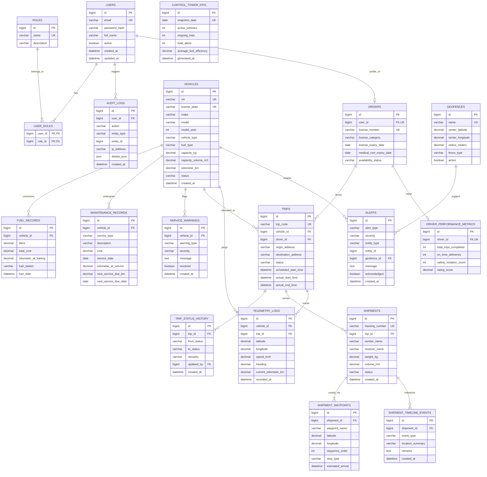

# FleetX — Intelligent Fleet & Logistics Management System
## Relational Database Design & Flyway Migration Architecture

**Document Reference:** FLEETX-DB-2026-V1.0  
**Target Engine:** MySQL 8.4 LTS  
**Storage Engine:** InnoDB  
**Character Set:** `utf8mb4` | **Collation:** `utf8mb4_0900_ai_ci`  
**Academic Year:** 2026–27  
**Baseline Date:** 10 October 2026  
**Status:** Approved Formal Database Specification (Phase 0)

---

## 1. Flyway Migration Versioning & Architectural Strategy

### 1.1 Strict Prohibition of Hibernate Auto-DDL
In accordance with project constraints, Hibernate's schema auto-mutation is disabled in `application.yml`:
```yaml
spring:
  jpa:
    hibernate:
      ddl-auto: validate
  flyway:
    enabled: true
    baseline-on-migrate: true
    locations: classpath:db/migration
```
All table definitions, index additions, and seed data must be executed solely through Flyway versioned SQL scripts.

### 1.2 Reserved Migration Version Ranges per Module
To ensure that all five student developers can work independently on their feature branches without version numbering collisions, the project reserves explicit integer version ranges:

| Module Identifier | Functional Domain | Reserved Flyway Range | Initial Migration File |
|---|---|:---:|---|
| **Module 1** | Identity & Admin | `V100` – `V199` | `V100__init_identity_schema.sql`<br>`V101__seed_roles_and_admin.sql` |
| **Module 2** | Fleet & Assets | `V200` – `V299` | `V200__init_fleet_schema.sql` |
| **Module 3** | Driver & Trip Operations | `V300` – `V399` | `V300__init_driver_trip_schema.sql` |
| **Module 4** | Shipment & Routes | `V400` – `V499` | `V400__init_shipment_route_schema.sql` |
| **Module 5** | Tracking & Control Tower | `V500` – `V599` | `V500__init_tracking_geofence_schema.sql` |

### 1.3 Integration Dependency Order
Flyway executes scripts in ascending numerical order (`V100` → `V200` → `V300` → `V400` → `V500`). This matches the natural relational dependencies of the domain:

```
┌─────────────────────────────────┐
│ Module 1: V100 - V199           │
│ (users, roles, audit_logs)      │
└───────────────┬─────────────────┘
                │
                ├──────────────────────────────────┐
                ▼                                  ▼
┌─────────────────────────────────┐ ┌─────────────────────────────────┐
│ Module 2: V200 - V299           │ │ Module 3: V300 - V399           │
│ (vehicles, fuel, maintenance)   │ │ (drivers, trips, history)       │
└───────────────┬─────────────────┘ └──────────────┬──────────────────┘
                │                                  │
                ├──────────────────────────────────┤
                ▼                                  ▼
┌─────────────────────────────────┐ ┌─────────────────────────────────┐
│ Module 4: V400 - V499           │ │ Module 5: V500 - V599           │
│ (shipments, waypoints, timeline)│ │ (telemetry, geofences, alerts)  │
└─────────────────────────────────┘ └─────────────────────────────────┘
```
1. `V100` creates foundational security and user accounts.
2. `V200` creates vehicle assets.
3. `V300` creates drivers (referencing `users.id`) and trips (referencing `vehicles.id` and `drivers.id`).
4. `V400` creates shipments and waypoints (referencing `trips.id`).
5. `V500` creates telemetry logs and geofences (referencing `vehicles.id` and `trips.id`).

---

## 2. Mermaid Entity-Relationship (ER) Diagram



---

## 3. Detailed Relational Schemas & Indexing Strategies

### 3.1 Module 1: Identity & Admin Schema (`V100`–`V199`)

#### Table: `users`
| Column | Type | Constraints | Description |
|---|---|---|---|
| `id` | `BIGINT` | `PRIMARY KEY AUTO_INCREMENT` | Internal user ID |
| `email` | `VARCHAR(180)` | `NOT NULL UNIQUE` | Login identifier |
| `password_hash`| `VARCHAR(255)` | `NOT NULL` | BCrypt hash string |
| `full_name` | `VARCHAR(120)` | `NOT NULL` | Full display name |
| `active` | `BOOLEAN` | `NOT NULL DEFAULT TRUE` | Account active flag |
| `created_at` | `DATETIME(6)` | `NOT NULL DEFAULT CURRENT_TIMESTAMP(6)` | Creation timestamp |
| `updated_at` | `DATETIME(6)` | `NOT NULL DEFAULT CURRENT_TIMESTAMP(6) ON UPDATE CURRENT_TIMESTAMP(6)` | Update timestamp |

- **Indexes:** `idx_users_email (email)`

#### Table: `roles`
| Column | Type | Constraints | Description |
|---|---|---|---|
| `id` | `BIGINT` | `PRIMARY KEY AUTO_INCREMENT` | Role ID |
| `name` | `VARCHAR(50)` | `NOT NULL UNIQUE` | Role enum name (e.g., `ROLE_ADMIN`) |
| `description` | `VARCHAR(255)` | `NULL` | Human description |

#### Table: `user_roles`
| Column | Type | Constraints | Description |
|---|---|---|---|
| `user_id` | `BIGINT` | `NOT NULL, FK -> users(id) ON DELETE CASCADE` | User reference |
| `role_id` | `BIGINT` | `NOT NULL, FK -> roles(id) ON DELETE CASCADE` | Role reference |
- **Composite Primary Key:** `(user_id, role_id)`

#### Table: `audit_logs`
| Column | Type | Constraints | Description |
|---|---|---|---|
| `id` | `BIGINT` | `PRIMARY KEY AUTO_INCREMENT` | Audit log entry ID |
| `user_id` | `BIGINT` | `NULL, FK -> users(id) ON DELETE SET NULL` | Performing user |
| `action` | `VARCHAR(80)` | `NOT NULL` | Action code (e.g., `USER_LOGIN`) |
| `entity_type` | `VARCHAR(60)` | `NULL` | Target aggregate (`TRIP`, `VEHICLE`) |
| `entity_id` | `BIGINT` | `NULL` | Target entity identifier |
| `ip_address` | `VARCHAR(45)` | `NULL` | IPv4 or IPv6 client address |
| `details_json`| `JSON` | `NULL` | Structured audit context |
| `created_at` | `DATETIME(6)` | `NOT NULL DEFAULT CURRENT_TIMESTAMP(6)` | Log timestamp |
- **Indexes:** `idx_audit_user_action (user_id, action)`, `idx_audit_created_at (created_at)`

---

### 3.2 Module 2: Fleet & Assets Schema (`V200`–`V299`)

#### Table: `vehicles`
| Column | Type | Constraints | Description |
|---|---|---|---|
| `id` | `BIGINT` | `PRIMARY KEY AUTO_INCREMENT` | Vehicle ID |
| `vin` | `VARCHAR(17)` | `NOT NULL UNIQUE` | Vehicle Identification Number |
| `license_plate`| `VARCHAR(20)`| `NOT NULL UNIQUE` | Official registration plate |
| `make` | `VARCHAR(60)` | `NOT NULL` | Manufacturer (e.g., Tata, Volvo) |
| `model` | `VARCHAR(60)` | `NOT NULL` | Model name |
| `model_year` | `INT` | `NOT NULL` | Manufacturing year |
| `vehicle_type`| `VARCHAR(30)` | `NOT NULL` | `TRUCK`, `VAN`, etc. |
| `fuel_type` | `VARCHAR(20)` | `NOT NULL` | `DIESEL`, `PETROL`, `ELECTRIC` |
| `capacity_kg` | `DECIMAL(10,2)`| `NOT NULL` | Payload capacity in kg |
| `capacity_volume_m3`| `DECIMAL(8,2)`| `NOT NULL`| Cargo volume in cubic meters |
| `odometer_km` | `DECIMAL(12,2)`| `NOT NULL DEFAULT 0.00`| Total distance traveled |
| `status` | `VARCHAR(30)` | `NOT NULL DEFAULT 'AVAILABLE'` | Asset status |
| `created_at` | `DATETIME(6)` | `NOT NULL DEFAULT CURRENT_TIMESTAMP(6)` | Registration timestamp |
- **Indexes:** `idx_vehicles_status (status)`, `idx_vehicles_license_plate (license_plate)`

#### Table: `fuel_records`
| Column | Type | Constraints | Description |
|---|---|---|---|
| `id` | `BIGINT` | `PRIMARY KEY AUTO_INCREMENT` | Fuel entry ID |
| `vehicle_id` | `BIGINT` | `NOT NULL, FK -> vehicles(id) ON DELETE CASCADE`| Vehicle reference |
| `liters` | `DECIMAL(8,2)` | `NOT NULL` | Fuel quantity in liters |
| `total_cost` | `DECIMAL(10,2)`| `NOT NULL` | Total cost in local currency |
| `odometer_at_fueling`| `DECIMAL(12,2)`| `NOT NULL`| Odometer reading at tank fill |
| `fuel_station`| `VARCHAR(120)` | `NULL` | Fuel provider / station name |
| `fuel_date` | `DATETIME(6)` | `NOT NULL` | Refueling timestamp |
- **Indexes:** `idx_fuel_vehicle_date (vehicle_id, fuel_date)`

#### Table: `maintenance_records`
| Column | Type | Constraints | Description |
|---|---|---|---|
| `id` | `BIGINT` | `PRIMARY KEY AUTO_INCREMENT` | Maintenance entry ID |
| `vehicle_id` | `BIGINT` | `NOT NULL, FK -> vehicles(id) ON DELETE CASCADE`| Vehicle reference |
| `service_type`| `VARCHAR(40)` | `NOT NULL` | `PREVENTIVE`, `REPAIR`, `INSPECTION` |
| `description` | `TEXT` | `NOT NULL` | Service notes |
| `cost` | `DECIMAL(10,2)`| `NOT NULL` | Invoiced service cost |
| `service_date`| `DATE` | `NOT NULL` | Date service was performed |
| `odometer_at_service`| `DECIMAL(12,2)`| `NOT NULL`| Vehicle odometer reading |
| `next_service_due_km`| `DECIMAL(12,2)`| `NULL`| Odometer threshold for next service |
| `next_service_due_date`| `DATE` | `NULL` | Date threshold for next service |
- **Indexes:** `idx_maint_vehicle_date (vehicle_id, service_date)`

#### Table: `service_warnings`
| Column | Type | Constraints | Description |
|---|---|---|---|
| `id` | `BIGINT` | `PRIMARY KEY AUTO_INCREMENT` | Warning ID |
| `vehicle_id` | `BIGINT` | `NOT NULL, FK -> vehicles(id) ON DELETE CASCADE`| Vehicle reference |
| `warning_type`| `VARCHAR(50)` | `NOT NULL` | `SERVICE_DUE_KM`, `SERVICE_DUE_DATE` |
| `severity` | `VARCHAR(20)` | `NOT NULL DEFAULT 'WARNING'` | Warning severity level |
| `message` | `VARCHAR(255)` | `NOT NULL` | Warning explanation |
| `resolved` | `BOOLEAN` | `NOT NULL DEFAULT FALSE`| Resolution state |
| `created_at` | `DATETIME(6)` | `NOT NULL DEFAULT CURRENT_TIMESTAMP(6)` | Warning timestamp |
- **Indexes:** `idx_warning_vehicle_unresolved (vehicle_id, resolved)`

---

### 3.3 Module 3: Driver & Trip Operations Schema (`V300`–`V399`)

#### Table: `drivers`
| Column | Type | Constraints | Description |
|---|---|---|---|
| `id` | `BIGINT` | `PRIMARY KEY AUTO_INCREMENT` | Driver ID |
| `user_id` | `BIGINT` | `NOT NULL UNIQUE, FK -> users(id) ON DELETE RESTRICT`| User account link |
| `license_number`| `VARCHAR(50)` | `NOT NULL UNIQUE` | Official license code |
| `license_category`| `VARCHAR(30)` | `NOT NULL` | `HEAVY`, `MEDIUM`, `LIGHT` |
| `license_expiry_date`| `DATE` | `NOT NULL` | Expiration date of license |
| `medical_cert_expiry_date`| `DATE` | `NULL` | Medical fitness certificate expiry |
| `availability_status`| `VARCHAR(30)`| `NOT NULL DEFAULT 'AVAILABLE'` | `AVAILABLE`, `ON_DUTY`, etc. |
- **Indexes:** `idx_drivers_availability (availability_status)`

#### Table: `trips`
| Column | Type | Constraints | Description |
|---|---|---|---|
| `id` | `BIGINT` | `PRIMARY KEY AUTO_INCREMENT` | Trip ID |
| `trip_code` | `VARCHAR(30)` | `NOT NULL UNIQUE` | Business code (`TRIP-2026-XXXX`) |
| `vehicle_id` | `BIGINT` | `NOT NULL, FK -> vehicles(id) ON DELETE RESTRICT` | Vehicle assigned |
| `driver_id` | `BIGINT` | `NOT NULL, FK -> drivers(id) ON DELETE RESTRICT` | Driver assigned |
| `origin_address`| `VARCHAR(255)` | `NOT NULL` | Origin dispatch hub |
| `destination_address`| `VARCHAR(255)`| `NOT NULL` | Destination delivery hub |
| `status` | `VARCHAR(30)` | `NOT NULL DEFAULT 'DRAFT'` | State machine state |
| `scheduled_start_time`| `DATETIME(6)`| `NOT NULL` | Scheduled departure |
| `actual_start_time`| `DATETIME(6)` | `NULL` | Actual departure time |
| `actual_end_time` | `DATETIME(6)` | `NULL` | Actual trip completion time |
| `created_at` | `DATETIME(6)` | `NOT NULL DEFAULT CURRENT_TIMESTAMP(6)` | Trip record creation |
- **Indexes:** `idx_trips_status (status)`, `idx_trips_vehicle (vehicle_id)`, `idx_trips_driver (driver_id)`

#### Table: `trip_status_history`
| Column | Type | Constraints | Description |
|---|---|---|---|
| `id` | `BIGINT` | `PRIMARY KEY AUTO_INCREMENT` | History log ID |
| `trip_id` | `BIGINT` | `NOT NULL, FK -> trips(id) ON DELETE CASCADE` | Associated trip |
| `from_status`| `VARCHAR(30)` | `NULL` | Status before transition |
| `to_status` | `VARCHAR(30)` | `NOT NULL` | Target state |
| `remarks` | `VARCHAR(255)` | `NULL` | Reason or dispatcher notes |
| `updated_by` | `BIGINT` | `NULL, FK -> users(id) ON DELETE SET NULL` | Performing user |
| `created_at` | `DATETIME(6)` | `NOT NULL DEFAULT CURRENT_TIMESTAMP(6)` | Event timestamp |
- **Indexes:** `idx_trip_history (trip_id, created_at)`

#### Table: `driver_performance_metrics`
| Column | Type | Constraints | Description |
|---|---|---|---|
| `id` | `BIGINT` | `PRIMARY KEY AUTO_INCREMENT` | Metric entry ID |
| `driver_id` | `BIGINT` | `NOT NULL UNIQUE, FK -> drivers(id) ON DELETE CASCADE`| Driver reference |
| `total_trips_completed`| `INT` | `NOT NULL DEFAULT 0` | Total finished trips |
| `on_time_deliveries` | `INT` | `NOT NULL DEFAULT 0` | On-time delivery count |
| `safety_violation_count`| `INT`| `NOT NULL DEFAULT 0` | Geofence / speeding alerts |
| `rating_score` | `DECIMAL(5,2)`| `NOT NULL DEFAULT 100.00` | Composite rating (0–100) |

---

### 3.4 Module 4: Shipment & Routes Schema (`V400`–`V499`)

#### Table: `shipments`
| Column | Type | Constraints | Description |
|---|---|---|---|
| `id` | `BIGINT` | `PRIMARY KEY AUTO_INCREMENT` | Shipment ID |
| `tracking_number`| `VARCHAR(30)` | `NOT NULL UNIQUE` | Business code (`SHP-2026-XXXX`) |
| `trip_id` | `BIGINT` | `NULL, FK -> trips(id) ON DELETE SET NULL` | Linked freight trip |
| `sender_name` | `VARCHAR(120)` | `NOT NULL` | Sender organization/person |
| `receiver_name`| `VARCHAR(120)` | `NOT NULL` | Recipient organization/person |
| `weight_kg` | `DECIMAL(10,2)`| `NOT NULL` | Consignment weight |
| `volume_m3` | `DECIMAL(8,2)` | `NOT NULL` | Consignment volume |
| `status` | `VARCHAR(30)` | `NOT NULL DEFAULT 'ORDERED'` | Cargo lifecycle state |
| `created_at` | `DATETIME(6)` | `NOT NULL DEFAULT CURRENT_TIMESTAMP(6)` | Order intake timestamp |
- **Indexes:** `idx_shipments_tracking (tracking_number)`, `idx_shipments_trip (trip_id)`

#### Table: `shipment_waypoints`
| Column | Type | Constraints | Description |
|---|---|---|---|
| `id` | `BIGINT` | `PRIMARY KEY AUTO_INCREMENT` | Waypoint ID |
| `shipment_id`| `BIGINT` | `NOT NULL, FK -> shipments(id) ON DELETE CASCADE` | Shipment reference |
| `waypoint_name`| `VARCHAR(120)`| `NOT NULL` | Location description |
| `latitude` | `DECIMAL(10,7)`| `NOT NULL` | Geographic latitude |
| `longitude` | `DECIMAL(10,7)`| `NOT NULL` | Geographic longitude |
| `sequence_order`| `INT` | `NOT NULL` | Stop sequence order (1..N) |
| `stop_type` | `VARCHAR(30)` | `NOT NULL` | `ORIGIN`, `INTERMEDIATE`, `DESTINATION` |
| `estimated_arrival`| `DATETIME(6)`| `NULL` | Calculated ETA |
- **Indexes:** `idx_waypoint_seq (shipment_id, sequence_order)`

#### Table: `shipment_timeline_events`
| Column | Type | Constraints | Description |
|---|---|---|---|
| `id` | `BIGINT` | `PRIMARY KEY AUTO_INCREMENT` | Event log ID |
| `shipment_id`| `BIGINT` | `NOT NULL, FK -> shipments(id) ON DELETE CASCADE` | Associated shipment |
| `event_type` | `VARCHAR(50)` | `NOT NULL` | Milestone event code |
| `location_summary`| `VARCHAR(255)`| `NULL` | Descriptive location string |
| `remarks` | `TEXT` | `NULL` | Additional context notes |
| `created_at` | `DATETIME(6)` | `NOT NULL DEFAULT CURRENT_TIMESTAMP(6)` | Milestone timestamp |
- **Indexes:** `idx_timeline_shipment (shipment_id, created_at)`

---

### 3.5 Module 5: Tracking & Control Tower Schema (`V500`–`V599`)

#### Table: `telemetry_logs`
| Column | Type | Constraints | Description |
|---|---|---|---|
| `id` | `BIGINT` | `PRIMARY KEY AUTO_INCREMENT` | Ping ID |
| `vehicle_id` | `BIGINT` | `NOT NULL, FK -> vehicles(id) ON DELETE CASCADE` | Vehicle pinged |
| `trip_id` | `BIGINT` | `NULL, FK -> trips(id) ON DELETE SET NULL` | Trip active during ping |
| `latitude` | `DECIMAL(10,7)`| `NOT NULL` | Current latitude |
| `longitude` | `DECIMAL(10,7)`| `NOT NULL` | Current longitude |
| `speed_kmh` | `DECIMAL(6,2)` | `NOT NULL DEFAULT 0.00` | Instantaneous velocity |
| `heading` | `DECIMAL(6,2)` | `NOT NULL DEFAULT 0.00` | Bearing in degrees (0–360) |
| `current_odometer_km`| `DECIMAL(12,2)`| `NOT NULL` | Telemetry odometer |
| `recorded_at`| `DATETIME(6)` | `NOT NULL` | Telemetry tick timestamp |
- **Indexes:** `idx_telemetry_vehicle_time (vehicle_id, recorded_at)`, `idx_telemetry_trip (trip_id)`

#### Table: `geofences`
| Column | Type | Constraints | Description |
|---|---|---|---|
| `id` | `BIGINT` | `PRIMARY KEY AUTO_INCREMENT` | Geofence ID |
| `name` | `VARCHAR(100)`| `NOT NULL UNIQUE` | Human boundary name |
| `center_latitude`| `DECIMAL(10,7)`| `NOT NULL` | Center coordinate latitude |
| `center_longitude`| `DECIMAL(10,7)`| `NOT NULL` | Center coordinate longitude |
| `radius_meters` | `DECIMAL(8,2)`| `NOT NULL` | Circular boundary radius |
| `fence_type` | `VARCHAR(30)` | `NOT NULL` | `DEPOT`, `CUSTOMER_HUB`, `RESTRICTED` |
| `active` | `BOOLEAN` | `NOT NULL DEFAULT TRUE` | Active boundary monitor |

#### Table: `alerts`
| Column | Type | Constraints | Description |
|---|---|---|---|
| `id` | `BIGINT` | `PRIMARY KEY AUTO_INCREMENT` | Alert ID |
| `alert_type` | `VARCHAR(50)` | `NOT NULL` | `GEOFENCE_BREACH`, `OVERSPEED`, etc. |
| `severity` | `VARCHAR(20)` | `NOT NULL DEFAULT 'WARNING'` | `INFO`, `WARNING`, `CRITICAL` |
| `entity_type`| `VARCHAR(40)` | `NOT NULL` | `VEHICLE`, `TRIP`, `DRIVER` |
| `entity_id` | `BIGINT` | `NOT NULL` | Identifier of the entity |
| `geofence_id`| `BIGINT` | `NULL, FK -> geofences(id) ON DELETE SET NULL` | Triggering geofence |
| `message` | `TEXT` | `NOT NULL` | Detailed incident message |
| `acknowledged`| `BOOLEAN` | `NOT NULL DEFAULT FALSE` | Resolved / triaged flag |
| `created_at` | `DATETIME(6)` | `NOT NULL DEFAULT CURRENT_TIMESTAMP(6)` | Incident trigger time |
- **Indexes:** `idx_alerts_unack (acknowledged, created_at)`

#### Table: `control_tower_kpis`
| Column | Type | Constraints | Description |
|---|---|---|---|
| `id` | `BIGINT` | `PRIMARY KEY AUTO_INCREMENT` | Record ID |
| `snapshot_date`| `DATE` | `NOT NULL UNIQUE` | Daily aggregated date |
| `active_vehicles`| `INT` | `NOT NULL DEFAULT 0` | Vehicles in transit |
| `ongoing_trips`| `INT` | `NOT NULL DEFAULT 0` | Active trips count |
| `total_alerts` | `INT` | `NOT NULL DEFAULT 0` | Total daily alerts emitted |
| `average_fuel_efficiency`| `DECIMAL(6,2)`| `NOT NULL DEFAULT 0.00` | Daily fleet average km/L |
| `generated_at`| `DATETIME(6)` | `NOT NULL DEFAULT CURRENT_TIMESTAMP(6)` | KPI batch execution time |
