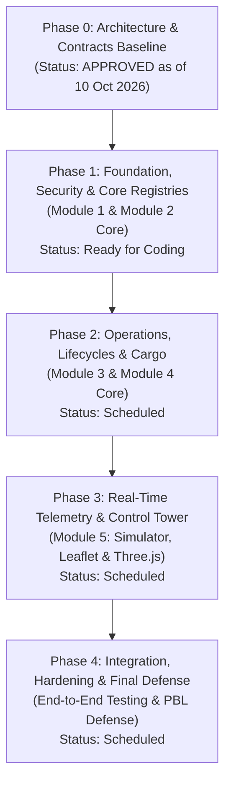

# FleetX — Intelligent Fleet & Logistics Management System
## Development Roadmap & Schedule Baseline

**Document Reference:** FLEETX-ROADMAP-2026-V1.0  
**Academic Year:** 2026–27  
**Baseline Planning Window:** 6 July 2026 – 6 October 2026  
**Architecture Review & Baseline Date:** 10 October 2026  
**Status:** Approved Phase 0 Baseline Schedule

---

## 1. Schedule Context & Baseline Notice

> [!IMPORTANT]
> **Schedule Interpretation Notice:**  
> The dates detailed in this roadmap reflect the academic planning baseline formulated between **6 July 2026 and 6 October 2026**. Today is **10 October 2026**.  
> The existence of a planned date range does **NOT** imply that business module implementation was completed. **Phase 0 (Architecture, Requirements, Contracts, Schema Design, and Team Workflow) is approved as of 10 October 2026.** Actual feature implementation begins in Phase 1 following this architecture sign-off. Progress must be validated exclusively through verifiable commit logs, passing test reports, and signed weekly audits.

---

## 2. Phased Development Lifecycle Overview

---

## 3. Detailed Phase Breakdown & Student Work Allocation

### Phase 0: System Architecture & Requirements (Baseline Complete)
- **Target Baseline:** 6 July 2026 – 20 July 2026 (Formal Sign-Off: 10 October 2026)
- **Status:** **APPROVED & COMPLETE**
- **Deliverables:**
  - `PROJECT_CHARTER.md`, `SRS.md`, `ARCHITECTURE.md`, `API_CONTRACTS.md`, `DATABASE_DESIGN.md`
  - `TEAM_OWNERSHIP.md`, `GITHUB_WORKFLOW.md`, `TEST_PLAN.md`, `DEVELOPMENT_ROADMAP.md`
  - Formal Flyway range reservations and Java shared interface contracts.

---

### Phase 1: Shared Foundation, Security & Asset Registries
- **Planned Target:** 21 July 2026 – 10 August 2026
- **Status:** **READY FOR IMPLEMENTATION**
- **Student Work Allocation:**
  - **Student 1 (Lead):** 
    - Setup Spring Boot 3.5.x & React Vite skeleton.
    - Implement `com.fleetx.common` (DTO records, base envelopes, `GlobalExceptionHandler`).
    - Implement Spring Security session configuration, BCrypt, CSRF token filters.
    - Module 1: Flyway `V100`–`V101`, User authentication (`/auth/login`, `/auth/me`), audit log repository.
  - **Student 2:** 
    - Module 2: Flyway `V200`, Vehicle asset CRUD (`/fleet/vehicles`), initial odometer validation.
    - Implement `VehicleLookupServiceImpl` fulfilling the `VehicleLookupService` contract.
  - **Students 3, 4, 5:** 
    - Set up feature directories in frontend.
    - Implement domain mock stubs for local testing.
- **Milestone 1 Gate:** User login produces authenticated session; Admin can provision vehicles; automated tests pass.

---

### Phase 2: Operations, Lifecycle State Machines & Cargo
- **Planned Target:** 11 August 2026 – 31 August 2026
- **Status:** **SCHEDULED**
- **Student Work Allocation:**
  - **Student 2:** 
    - Module 2: Fuel tracking (`/fuel-records`), km/L efficiency calculations, maintenance logs, automated service warnings.
  - **Student 3:** 
    - Module 3: Flyway `V300`, Driver profiles and license expiration checks.
    - Implement `DriverLookupServiceImpl` and `TripLookupServiceImpl`.
    - Trip creation engine with pre-assignment asset validation.
    - Trip state machine (`DRAFT` → `ASSIGNED` → `IN_TRANSIT` → `COMPLETED`).
  - **Student 4:** 
    - Module 4: Flyway `V400`, Cargo shipment CRUD (`/shipments`), route waypoints planning.
    - Implement `ShipmentLookupServiceImpl`.
    - Delivery milestone timeline and Haversine distance/ETA computation.
- **Milestone 2 Gate:** Complete dispatch workflow: Admin registers vehicle → Dispatcher assigns available driver & vehicle to trip with shipments → Trip advances to `IN_TRANSIT`.

---

### Phase 3: Real-Time Telemetry, 2D/3D Visualization & Alerts
- **Planned Target:** 1 September 2026 – 21 September 2026
- **Status:** **SCHEDULED**
- **Student Work Allocation:**
  - **Student 5:** 
    - Module 5: Flyway `V500`, GPS Telemetry Simulator engine (coordinate interpolation along waypoints).
    - WebSocket / STOMP broker integration (`/ws/fleetx`, `/topic/vehicles/{id}`).
    - Circular geofence breach detection and `AlertPublisherImpl`.
    - 2D Leaflet interactive map with vehicle markers and route polylines.
    - Stylized 3D Three.js fleet status canvas.
    - Control Tower KPI summary dashboard and CSV export engine.
  - **Students 1–4:** 
    - Integrate module views with live alert feeds.
    - Build remaining React feature pages for vehicles, trips, and shipments.
- **Milestone 3 Gate:** Simulated trip broadcasts real-time GPS pings to both Leaflet 2D map and Three.js 3D canvas; geofence exit triggers real-time alert toast.

---

### Phase 4: Integration, System Hardening & Academic Defense
- **Planned Target:** 22 September 2026 – 6 October 2026
- **Status:** **SCHEDULED**
- **Student Work Allocation:**
  - **All Students (1–5):**
    - Execute end-to-end integration test suites across all five modules.
    - Verify CSRF protection, role authorization, and session timeout behaviors.
    - Resolve performance bottlenecks and optimize MySQL indexes.
    - Generate sample operational dataset (50 vehicles, 100 trips, 300 shipments).
    - Compile final academic PBL project report, use-case/ER/class diagrams, and presentation slide deck.
- **Final Milestone Gate:** Successful live demo to faculty committee; 100% test pass rate; zero critical bugs.

---

## 4. Scope Classification: Mandatory MVP vs Optional Enhancements

| Module | Mandatory Core MVP (Must Deliver for PBL Submission) | Optional Enhancements (Deferred / Bonus) |
|---|---|---|
| **Mod 1: Identity** | Session login, BCrypt hashing, CSRF tokens, 5 roles, user CRUD, audit logs. | Self-service password reset email link; two-factor authentication (2FA). |
| **Mod 2: Fleet** | Vehicle CRUD, status tracking, fuel records, km/L efficiency, service warnings. | Total Cost of Ownership (TCO) depreciation curves; tire wear tracking. |
| **Mod 3: Operations** | Driver compliance, license checks, asset assignment validation, trip state machine. | Automated driver rest break alerts; mobile driver push notifications. |
| **Mod 4: Shipments** | Cargo CRUD, ordered waypoints, milestone timeline, Haversine distance & ETA. | Traveling Salesperson (TSP) route optimization; dynamic traffic API. |
| **Mod 5: Tracking** | GPS simulator, WebSocket STOMP, Leaflet 2D map, Three.js 3D canvas, geofences, CSV export. | Complex polygon geofencing; animated 3D truck CAD model textures. |

---

## 5. Risk Assessment & Mitigation Matrix

| Risk ID | Description | Severity | Likelihood | Mitigation Strategy |
|---|---|:---:|:---:|---|
| `RSK-01` | Integration friction from conflicting student code | High | Medium | Enforced package-by-feature layout, shared contracts, and mandatory two-reviewer PR approvals. |
| `RSK-02` | Database migration collisions on shared MySQL | High | Low | Reserved Flyway version ranges (`V100`–`V599`); students never touch each other's ranges. |
| `RSK-03` | Three.js WebGL performance lag on classroom hardware | Medium | Medium | Use lightweight low-polygon geometries and simple shaders; fallback gracefully to 2D Leaflet map. |
| `RSK-04` | Scope creep causing missed academic deadline | High | High | Strict MVP boundary enforcement; all non-essential features classified as Optional. |
| `RSK-05` | Unequal team contribution causing grading penalty | High | Low | Clear individual module ownership (1 student per module) and mandatory weekly evidence logs. |
