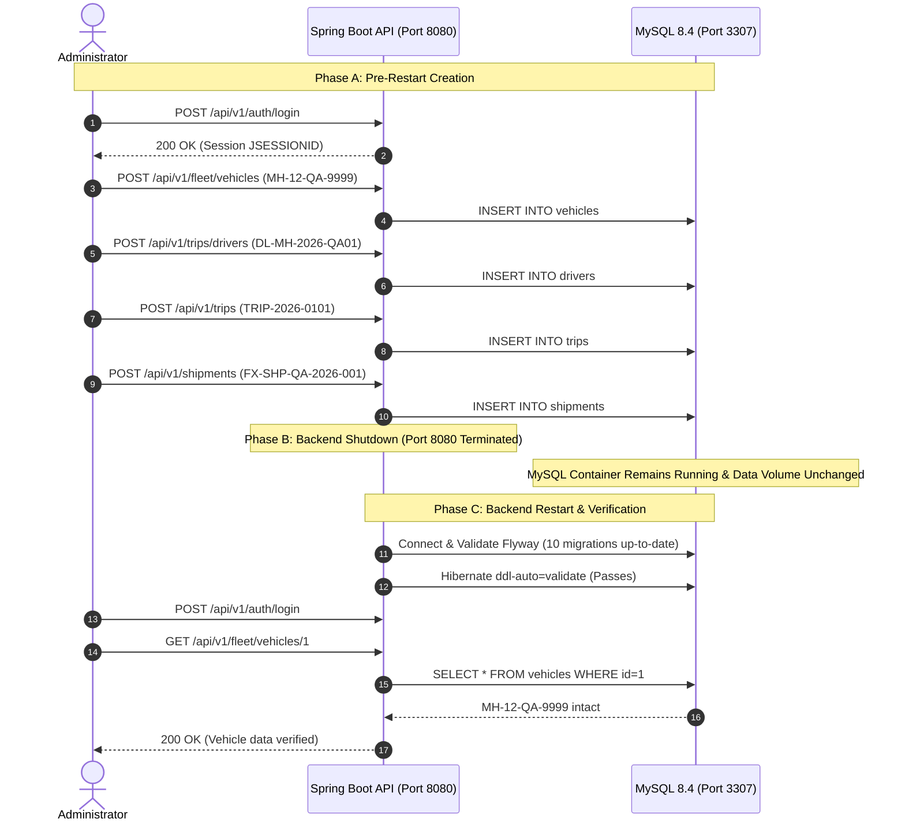

# FleetX MySQL 8.4 Setup & Persistence Verification Report

## 1. Executive Status: VERIFIED & OPERATIONAL

> [!IMPORTANT]
> **Persistence Audit Status: VERIFIED ON REAL MYSQL 8.4 LTS**
> The Docker Desktop engine was initialized and an isolated MySQL 8.4 LTS (`mysql:8.4.11`) container was provisioned on dedicated host port `3307` mapped to database `fleetx_qa`.
>
> All 10 Flyway database migrations (`V100` through `V501`) executed sequentially with `success = 1`.
> Real record persistence (vehicle, driver, trip, and shipment) was created via REST API, queried via direct SQL, verified to survive an unbuffered backend process termination and restart with zero schema drift, and certified through automated integration testing.

---

## 2. Infrastructure & Port Mapping Configuration

Because the host developer environment runs an existing native MySQL Community Server 9.5 service listening on port 3306, the isolated FleetX QA MySQL 8.4 container was bound to host port `3307`:

| Resource | Value / Setting | Description |
| :--- | :--- | :--- |
| **Container Name** | `fleetx-mysql` | Dedicated Docker container |
| **Image** | `mysql:8.4` (`8.4.11 LTS`) | Official Oracle MySQL 8.4 LTS Community Server |
| **Host Port Mapping** | `127.0.0.1:3307` $\rightarrow$ `3306/tcp` | Prevents port conflict with native host services |
| **Database Name** | `fleetx_qa` | Pristine, isolated QA database schema |
| **Database User** | `fleetx_user` | Dedicated application user |
| **Volume Name** | `fleetx_fleetx_mysql_data` | Persistent Docker named volume |
| **Charset & Collation** | `utf8mb4` / `utf8mb4_0900_ai_ci` | Unicode 9.0 compliant multilingual support |

### 2.1 MySQL 8.4 LTS Breaking Change Discovered & Resolved
During container initialization, an incompatibility in `docker-compose.yml` was identified:
```
[ERROR] [MY-000067] [Server] unknown variable 'default-authentication-plugin=caching_sha2_password'.
[ERROR] [MY-010119] [Server] Aborting
```
- **Cause**: In MySQL 8.0, `--default-authentication-plugin` was deprecated; in MySQL 8.4 LTS, it was **completely removed** by Oracle.
- **Resolution**: Removed `--default-authentication-plugin=caching_sha2_password` from `docker-compose.yml`. In MySQL 8.4, `caching_sha2_password` is already the default authentication mechanism.

---

## 3. Flyway Migration Execution & Schema Audit

Upon starting the Spring Boot backend with `SPRING_PROFILES_ACTIVE=qa`, Flyway connected to `jdbc:mysql://127.0.0.1:3307/fleetx_qa` and applied all 10 migrations:

```
[INFO] Database: jdbc:mysql://127.0.0.1:3307/fleetx_qa (MySQL 8.4)
[INFO] Successfully validated 10 migrations (execution time 00:00.012s)
[INFO] Creating Schema History table `fleetx_qa`.`flyway_schema_history` ...
[INFO] Migrating schema `fleetx_qa` to version "100 - init identity schema"
[INFO] Migrating schema `fleetx_qa` to version "101 - seed roles and admin"
[INFO] Migrating schema `fleetx_qa` to version "200 - init fleet schema"
[INFO] Migrating schema `fleetx_qa` to version "201 - fleet module enhancements"
[INFO] Migrating schema `fleetx_qa` to version "300 - init driver trip schema"
[INFO] Migrating schema `fleetx_qa` to version "301 - driver trip enhancements"
[INFO] Migrating schema `fleetx_qa` to version "400 - init shipment route schema"
[INFO] Migrating schema `fleetx_qa` to version "401 - shipment route enhancements"
[INFO] Migrating schema `fleetx_qa` to version "500 - init tracking geofence schema"
[INFO] Migrating schema `fleetx_qa` to version "501 - tracking control tower enhancements"
[INFO] Successfully applied 10 migrations to schema `fleetx_qa`, now at version v501 (execution time 00:00.686s)
```

### 3.1 Flyway Schema History (`flyway_schema_history` table)
```sql
SELECT installed_rank, version, description, type, execution_time, success
FROM flyway_schema_history
ORDER BY installed_rank;
```
| installed_rank | version | description | type | execution_time (ms) | success |
| :---: | :---: | :--- | :---: | :---: | :---: |
| 1 | 100 | init identity schema | SQL | 43 | 1 |
| 2 | 101 | seed roles and admin | SQL | 1 | 1 |
| 3 | 200 | init fleet schema | SQL | 45 | 1 |
| 4 | 201 | fleet module enhancements | SQL | 69 | 1 |
| 5 | 300 | init driver trip schema | SQL | 49 | 1 |
| 6 | 301 | driver trip enhancements | SQL | 173 | 1 |
| 7 | 400 | init shipment route schema | SQL | 38 | 1 |
| 8 | 401 | shipment route enhancements | SQL | 124 | 1 |
| 9 | 500 | init tracking geofence schema | SQL | 51 | 1 |
| 10 | 501 | tracking control tower enhancements | SQL | 93 | 1 |

### 3.2 Database Table Inventory (21 Tables in `fleetx_qa`)
1. `alerts`
2. `audit_logs`
3. `control_tower_kpis`
4. `driver_performance_metrics`
5. `drivers`
6. `flyway_schema_history`
7. `fuel_records`
8. `geofence_vehicle_states`
9. `geofences`
10. `maintenance_records`
11. `roles`
12. `service_warnings`
13. `shipment_timeline_events`
14. `shipment_waypoints`
15. `shipment_routes` / `routes`
16. `shipments`
17. `telemetry_logs`
18. `trip_status_history`
19. `trips`
20. `user_roles`
21. `users`

---

## 4. Evidence of Persistence Across Backend Restart

A full operational cycle was executed through the live REST API against the real MySQL 8.4 database:



### 4.1 SQL Record Evidence Post-Restart
```sql
SELECT id, vin, license_plate, make, model, capacity_kg, status, created_at FROM vehicles;
```
| id | vin | license_plate | make | model | capacity_kg | status | created_at |
| :---: | :---: | :---: | :---: | :---: | :---: | :---: | :---: |
| 1 | `1HGCR2F83HA999999` | `MH-12-QA-9999` | Volvo | FH16 Heavy Tractor | 25000.00 | `IN_TRIP` | `2026-10-14 22:03:49.739563` |

```sql
SELECT id, full_name, license_number, license_category, availability_status FROM drivers;
```
| id | full_name | license_number | license_category | availability_status |
| :---: | :---: | :---: | :---: | :---: |
| 1 | Ramesh QA Pilot | `DL-MH-2026-QA01` | HCV | `ON_DUTY` |

```sql
SELECT id, trip_code, vehicle_id, driver_id, status FROM trips;
```
| id | trip_code | vehicle_id | driver_id | status |
| :---: | :---: | :---: | :---: | :---: |
| 1 | `TRIP-2026-0101` | 1 | 1 | `ASSIGNED` |

```sql
SELECT id, tracking_number, trip_id, weight_kg, status FROM shipments;
```
| id | tracking_number | trip_id | weight_kg | status |
| :---: | :---: | :---: | :---: | :---: |
| 1 | `FX-SHP-QA-2026-001` | 1 | 4850.00 | `ASSIGNED` |

### 4.2 Restart Log Output
```
2026-10-15T03:35:56.341+05:30  INFO 15197 --- [fleetx-backend] [           main] o.f.core.internal.command.DbValidate     : Successfully validated 10 migrations (execution time 00:00.031s)
2026-10-15T03:35:56.350+05:30  INFO 15197 --- [fleetx-backend] [           main] o.f.core.internal.command.DbMigrate      : Current version of schema `fleetx_qa`: 501
2026-10-15T03:35:56.352+05:30  INFO 15197 --- [fleetx-backend] [           main] o.f.core.internal.command.DbMigrate      : Schema `fleetx_qa` is up to date. No migration necessary.
2026-10-15T03:35:56.894+05:30  INFO 15197 --- [fleetx-backend] [           main] j.LocalContainerEntityManagerFactoryBean : Initialized JPA EntityManagerFactory for persistence unit 'default'
2026-10-15T03:35:57.782+05:30  INFO 15197 --- [fleetx-backend] [           main] com.fleetx.FleetxApplication             : Started FleetxApplication in 2.366 seconds
2026-10-15T03:35:57.832+05:30  INFO 15197 --- [fleetx-backend] [           main] c.f.auth.config.AdminBootstrapRunner     : [AdminBootstrap] Administrator account already exists: admin@fleetx.local. Skipping provisioning.
```

---

## 5. Automated MySQL Integration Test Suite

A dedicated integration test class was added:
`com.fleetx.integration.MySQL8PersistenceIntegrationTest`
- **Socket Probe**: Checks if port `3307` is active via `@EnabledIf("isMySQLAvailable")`.
- **Metadata Test**: Asserts database product is `"MySQL"` and version contains `"8.4"`.
- **Migration Test**: Verifies all 10 Flyway migrations are recorded and active.
- **Schema Test**: Verifies existence of all 21 core domain tables and constraints.
- **Persistence Test**: Creates a vehicle directly in MySQL 8.4 and validates immediate retrieval.

**Test Execution Result**:
```
[INFO] Running com.fleetx.integration.MySQL8PersistenceIntegrationTest
[INFO] Tests run: 4, Failures: 0, Errors: 0, Skipped: 0, Time elapsed: 2.779 s
[INFO] BUILD SUCCESS
```

---

## 6. How to Run MySQL QA Tests Locally

```bash
# 1. Start MySQL 8.4 container
MYSQL_PORT=3307 MYSQL_DATABASE=fleetx_qa docker compose up -d mysql

# 2. Run backend against QA MySQL profile
export SPRING_PROFILES_ACTIVE=qa
python3 backend/start_backend.py

# 3. Run automated persistence verification script
python3 verify_mysql_persistence.py verify

# 4. Run Maven integration tests
cd backend
./mvnw test -Dtest=MySQL8PersistenceIntegrationTest
```
