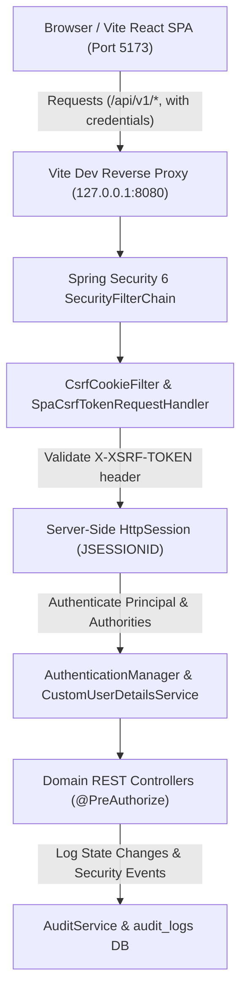

# FleetX Security Configuration & Hardening Guide

## 1. Executive Security Architecture Overview

FleetX employs a defense-in-depth security model combining server-side HTTP session management, double-submit cookie CSRF mitigation with Single-Page Application (SPA) compatibility, BCrypt password hashing, method-level and URL-level Role-Based Access Control (RBAC), and strict origin restrictions on HTTP and WebSocket channels.

---

## 2. Authentication & Session Architecture

### 2.1 State & Session Lifecycle
- **Mechanism**: Server-side HTTP Sessions managed by Spring Security (`SessionCreationPolicy.IF_REQUIRED`).
- **Session Identifier**: `JSESSIONID` cookie.
- **Session Timeout**: 30 minutes of inactivity (`server.servlet.session.timeout=30m`).
- **Session Invalidation**: Calling `POST /api/v1/auth/logout` explicitly invalidates `HttpSession`, clears the `SecurityContext`, and clears browser authentication state.

### 2.2 Cookie Attributes & Environment Hardening
| Cookie | Attribute | Development (`dev`) | Production (`prod`) | Rationale |
| :--- | :--- | :--- | :--- | :--- |
| `JSESSIONID` | `HttpOnly` | `true` | `true` | Prevents client-side JavaScript / XSS access to session token. |
| `JSESSIONID` | `SameSite` | `Lax` | `Strict` | Defends against Cross-Site Request Forgery on external navigations. |
| `JSESSIONID` | `Secure` | `false` (configurable) | `true` (`${COOKIE_SECURE:true}`) | Forces browser to transmit session cookie solely over encrypted HTTPS channels in production. |
| `XSRF-TOKEN` | `HttpOnly` | `false` | `false` | Required so SPA client (Axios interceptor) can read the token and mirror it in the `X-XSRF-TOKEN` HTTP header. |
| `XSRF-TOKEN` | `SameSite` | `Lax` | `Lax` | Prevents cross-site token exfiltration. |

---

## 3. CSRF Protection (Spring Security 6 SPA Standard)

FleetX implements the Spring Security 6 recommended CSRF architecture for single-page applications:
1. **Cookie Repository**: `CookieCsrfTokenRepository.withHttpOnlyFalse()` sets the `XSRF-TOKEN` cookie.
2. **SPA Token Request Handler**: Custom `SpaCsrfTokenRequestHandler` delegates to `XorCsrfTokenRequestAttributeHandler` while accepting the raw token value sent by the React frontend in the `X-XSRF-TOKEN` header.
3. **Cookie Priming Filter**: `CsrfCookieFilter` guarantees that every incoming request causes Spring Security to evaluate and emit the `XSRF-TOKEN` cookie on the response if not already present.
4. **Exempt Endpoints**:
   - `GET /api/health` (public monitoring probe)
   - `POST /api/v1/auth/login` (initial session establishment)
   - `GET /api/v1/auth/csrf` (explicit CSRF token handshake endpoint)
   - `/ws/fleetx/**` (WebSocket STOMP handshake)

---

## 4. Password Security & Hashing

- **Algorithm**: `BCryptPasswordEncoder` with work factor 12 (`new BCryptPasswordEncoder(12)`).
- **Entropy**: Key derivation utilizes 4096 rounds of Blowfish key scheduling with unique cryptographic salt per user.
- **Storage**: Plaintext passwords are never stored, logged, or exposed in API responses (`UserDto` strips password hashes).
- **Validation**: Passwords must meet minimum complexity (minimum 8 characters, combination of uppercase, lowercase, numbers, and special symbols).

---

## 5. Role-Based Access Control (RBAC) Matrix

FleetX implements strict least-privilege authorization using URL pattern guards in `SecurityConfig` and method-level `@PreAuthorize("hasRole('...')")` annotations on service/controller layers.

| Module / Resource | Endpoint Pattern | ADMIN | FLEET_MANAGER | DISPATCHER | DRIVER | VIEWER |
| :--- | :--- | :---: | :---: | :---: | :---: | :---: |
| **System Health** | `GET /api/health` | Allow | Allow | Allow | Allow | Allow |
| **Authentication** | `POST /api/v1/auth/login` | Allow | Allow | Allow | Allow | Allow |
| **Auth Session** | `GET /api/v1/auth/me` | Allow | Allow | Allow | Allow | Allow |
| **Auth Logout** | `POST /api/v1/auth/logout` | Allow | Allow | Allow | Allow | Allow |
| **User Management** | `GET/POST /api/v1/admin/users/**` | **Allow** | Deny (403) | Deny (403) | Deny (403) | Deny (403) |
| **Fleet Inventory** | `GET /api/v1/fleet/vehicles/**` | Allow | Allow | Allow | Allow | Allow |
| **Fleet Mutations** | `POST/PUT/DELETE /api/v1/fleet/**` | **Allow** | **Allow** | Deny (403) | Deny (403) | Deny (403) |
| **Driver Rosters** | `GET /api/v1/trips/drivers/**` | Allow | Allow | Allow | Deny (403) | Allow |
| **Driver Mutations**| `POST/PUT /api/v1/trips/drivers/**` | **Allow** | **Allow** | Deny (403) | Deny (403) | Deny (403) |
| **Trip Dispatch** | `GET /api/v1/trips/**` | Allow | Allow | Allow | Allow (Assigned)| Allow |
| **Trip Creation** | `POST /api/v1/trips` | **Allow** | **Allow** | **Allow** | Deny (403) | Deny (403) |
| **Trip Operations**| `PATCH /api/v1/trips/{id}/**` | **Allow** | **Allow** | **Allow** | **Allow** (Self) | Deny (403) |
| **Shipments Read** | `GET /api/v1/shipments/**` | Allow | Allow | Allow | Allow | Allow |
| **Shipment Write** | `POST/PUT /api/v1/shipments/**` | **Allow** | **Allow** | **Allow** | Deny (403) | Deny (403) |
| **Live Tracking** | `GET /api/v1/tracking/**` | Allow | Allow | Allow | Allow | Allow |
| **GPS Simulator** | `POST /api/v1/tracking/simulator/**`| **Allow** | **Allow** | **Allow** | Deny (403) | Deny (403) |
| **CSV Reports** | `GET /api/v1/tracking/reports/**`| Allow | Allow | Allow | Deny (403) | Allow |

---

## 6. Origin Restrictions (CORS & WebSockets)

Wildcard (`*`) origins are prohibited across all configurations.

### 6.1 HTTP CORS Configuration
- Configured in `SecurityConfig.corsConfigurationSource()`
- Uses Spring property `${fleetx.cors.allowed-origins}` with dev fallback to:
  - `http://localhost:5173`
  - `http://127.0.0.1:5173`
- Allowed HTTP Methods: `GET`, `POST`, `PUT`, `PATCH`, `DELETE`, `OPTIONS`
- `AllowCredentials`: `true` (enables `JSESSIONID` and `XSRF-TOKEN` cookie handling)
- `MaxAge`: 3600 seconds

### 6.2 WebSocket STOMP Endpoint Security
- Configured in `WebSocketConfig.registerStompEndpoints()`
- STOMP handshake endpoint: `/ws/fleetx`
- Allowed Origin Patterns: dynamically bound to the same `${fleetx.cors.allowed-origins}` list
- Disallows unknown external origins from establishing full-duplex socket connections.

---

## 7. Production Secrets & Environment Variables

The production profile (`application-prod.yml`) enforces a fail-fast policy. If required infrastructure credentials are omitted, the application container terminates immediately during startup rather than falling back to in-memory databases or default passwords.

### Required Production Environment Variables
| Variable Name | Purpose | Example / Format |
| :--- | :--- | :--- |
| `SPRING_PROFILES_ACTIVE` | Activates production profile | `prod` |
| `DB_HOST` / `SPRING_DATASOURCE_URL` | MySQL Server hostname or full JDBC URL | `mysql.production.internal` / `jdbc:mysql://...` |
| `SPRING_DATASOURCE_USERNAME` | Production MySQL Database User | `fleetx_prod_app` |
| `SPRING_DATASOURCE_PASSWORD` | Strong DB password ($\ge 16$ chars) | `K9#m$L2!zP@91...` |
| `COOKIE_SECURE` | Enforces HTTPS-only cookies | `true` |
| `CORS_ALLOWED_ORIGINS` | Permitted frontend domains | `https://fleetx.company.com` |
| `BOOTSTRAP_ADMIN_ENABLED` | First-time administrator creation | `false` (default) or `true` |
| `BOOTSTRAP_ADMIN_PASSWORD` | Password for bootstrapped admin | `StrongInitialAdminPass!` |
| `DEMO_SEED_ENABLED` | Demo dataset generation | **Strictly `false` in production** |
