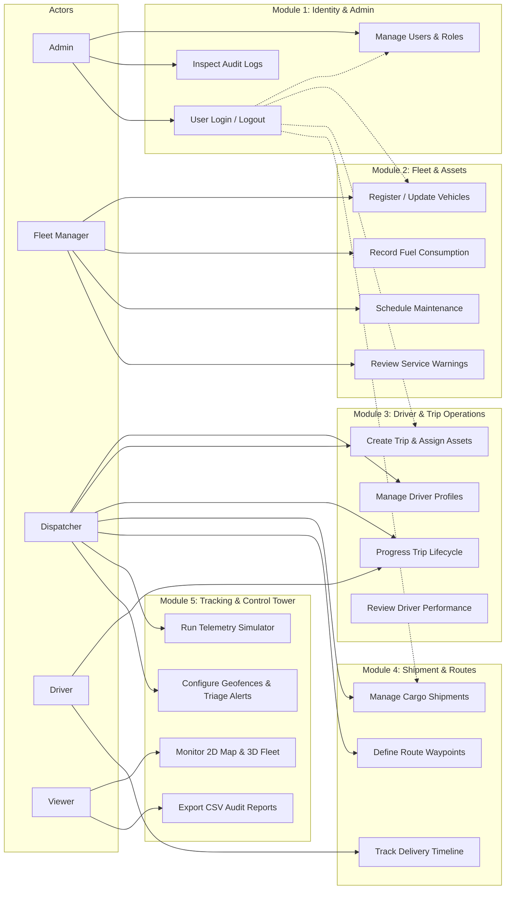

# FleetX — Intelligent Fleet & Logistics Management System
## Software Requirements Specification (SRS)

**Document Reference:** FLEETX-SRS-2026-V1.0  
**Standard Compliance:** IEEE 830 / ISO/IEC/IEEE 29148 Baseline  
**Academic Year:** 2026–27  
**Baseline Date:** 10 October 2026  
**Status:** Approved Architecture Specification (Phase 0)

---

## 1. Introduction

### 1.1 Purpose
This Software Requirements Specification (SRS) defines the complete functional and non-functional requirements for the **FleetX — Intelligent Fleet & Logistics Management System**. FleetX is developed as a collegiate Project-Based Learning (PBL) software engineering project by a dedicated five-student engineering squad. This document serves as the formal contractual agreement between project stakeholders, faculty evaluators, and the engineering squad.

### 1.2 Document Conventions
- **Requirement IDs:** Structured as `FR-[MODULE]-[ID]` for Functional Requirements and `NFR-[CATEGORY]-[ID]` for Non-Functional Requirements.
- **Priority Labels:**
  - `[MANDATORY-MVP]`: Core requirement indispensable for academic submission and operational functionality.
  - `[OPTIONAL-ENHANCEMENT]`: Desirable secondary enhancement to be tackled if sprint capacity permits.
- **RFC 2119 Terms:** The key words "MUST", "MUST NOT", "REQUIRED", "SHALL", "SHOULD", and "MAY" are to be interpreted as described in RFC 2119.

### 1.3 Intended Audience
- **Faculty Evaluation Committee & Mentors:** For grading, architectural verification, and progress auditing.
- **Engineering Squad (Students 1–5):** For feature design, implementation boundaries, and testing.
- **External Reviewers & Auditors:** For verification of enterprise standards in collegiate development.

### 1.4 Product Scope
FleetX is a modular monolithic web application delivering end-to-end fleet tracking, logistics dispatching, preventive asset maintenance, and real-time telemetry streaming for regional freight operations.

---

## 2. Overall Description

### 2.1 Product Perspective
FleetX operates as a single deployable modular monolith backed by MySQL 8.4 LTS. It integrates a server-side session-authenticated REST backend (Java 21, Spring Boot 3.5.x) with a modern Single-Page Application (SPA) frontend (React, Vite, TypeScript, Bootstrap 5). Real-time telemetry is streamed via STOMP over WebSockets.

```
┌────────────────────────────────────────────────────────────────────────┐
│                          REACT SPA CLIENT                              │
│  ┌──────────────┬──────────────┬──────────────┬─────────────────────┐  │
│  │ Bootstrap UI │ Leaflet 2D   │ Three.js 3D  │ STOMP Client (SockJS│  │
│  └──────────────┴──────────────┴──────────────┴─────────────────────┘  │
└───────────────────────────────────┬────────────────────────────────────┘
                                    │ HTTPS (REST) / WSS (STOMP)
                                    ▼
┌────────────────────────────────────────────────────────────────────────┐
│                   SPRING BOOT 3.5.x MODULAR MONOLITH                   │
│  ┌────────────┬─────────────┬─────────────┬─────────────┬───────────┐  │
│  │ Module 1   │ Module 2    │ Module 3    │ Module 4    │ Module 5  │  │
│  │ Identity   │ Fleet/Asset │ Trip/Driver │ Shipments   │ Tracking  │  │
│  └────────────┴─────────────┴─────────────┴─────────────┴───────────┘  │
│  ┌──────────────────────────────────────────────────────────────────┐  │
│  │ Spring Security (Session + CSRF) │ Spring Data JPA │ Flyway      │  │
│  └──────────────────────────────────────────────────────────────────┘  │
└───────────────────────────────────┬────────────────────────────────────┘
                                    │ JDBC / TCP 3306
                                    ▼
┌────────────────────────────────────────────────────────────────────────┐
│                            MySQL 8.4 LTS                               │
└────────────────────────────────────────────────────────────────────────┘
```

### 2.2 User Roles & Permissions Matrix
The system recognizes five distinct user personas:

| Functional Area | Admin | Fleet Manager | Dispatcher | Driver | Viewer |
|---|:---:|:---:|:---:|:---:|:---:|
| User Management & Role Assignment | **CRUD** | No Access | No Access | No Access | No Access |
| System Audit Log Inspection | **Read** | No Access | No Access | No Access | No Access |
| Vehicle Registration & Specifications | **CRUD** | **CRUD** | Read | Read | Read |
| Fuel Records & Efficiency Logs | **CRUD** | **CRUD** | Read | Read | Read |
| Maintenance Records & Warnings | **CRUD** | **CRUD** | Read | No Access | Read |
| Driver Profiles & Availability Management | **CRUD** | Read | **CRUD** | Read (Self) | Read |
| Trip Creation, Scheduling & Assignment | **CRUD** | Read | **CRUD** | Read (Assigned)| Read |
| Trip Status Progression (In-Transit/Complete)| **Update** | No Access | **Update** | **Update (Self)**| Read |
| Shipment Manifests & Waypoint Planning | **CRUD** | Read | **CRUD** | Read (Assigned)| Read |
| Delivery Timeline Milestone Updates | **Update** | No Access | **Update** | **Update (Self)**| Read |
| GPS Telemetry Simulator Control | **Execute**| No Access | **Execute** | No Access | No Access |
| Live 2D Map & 3D Fleet Visualizer | **Read** | **Read** | **Read** | Read (Self) | **Read** |
| Geofence Boundary Configuration | **CRUD** | **CRUD** | **CRUD** | No Access | Read |
| Alert Resolution & Notification Triage | **CRUD** | **Update** | **Update** | Read (Self) | Read |
| Control Tower Dashboard & CSV Export | **Read/Export**| **Read/Export**| **Read/Export**| No Access | **Read/Export**|

---

## 3. Use-Case Diagram

The following Mermaid diagram visualizes the primary interactions across all five actors:



---

## 4. Functional Requirements

### 4.1 Module 1: Identity & Admin (Owner: Student 1 / Leader)

- **`FR-ADM-01` [MANDATORY-MVP] Session-Based Authentication:**
  The system MUST authenticate users using email/username and password, maintaining authenticated state via Spring Security server-side HTTP sessions (`JSESSIONID`). Plaintext passwords MUST NEVER be stored; passwords MUST be hashed using BCrypt (`strength = 12`).
- **`FR-ADM-02` [MANDATORY-MVP] CSRF Defense:**
  All state-changing HTTP requests (`POST`, `PUT`, `DELETE`, `PATCH`) MUST require a valid CSRF token exchanged via `CookieCsrfTokenRepository` or session-stored token.
- **`FR-ADM-03` [MANDATORY-MVP] User Administration:**
  Admins MUST be able to create, read, update, activate, and deactivate user accounts. Each user MUST be assigned at least one role from the defined roles: `ADMIN`, `FLEET_MANAGER`, `DISPATCHER`, `DRIVER`, `VIEWER`.
- **`FR-ADM-04` [MANDATORY-MVP] Tamper-Evident Audit Logging:**
  The system MUST asynchronously record an audit log entry for all critical security and domain events (logins, failed attempts, role changes, trip status changes, vehicle decommissioning). Each log entry MUST record `user_id`, `action`, `entity_type`, `entity_id`, `ip_address`, `timestamp`, and `details_json`.
- **`FR-ADM-05` [OPTIONAL-ENHANCEMENT] Password Reset via Secure Token:**
  Support time-limited, single-use password reset tokens sent via email simulation or administrator override.

### 4.2 Module 2: Fleet & Assets (Owner: Student 2)

- **`FR-FLT-01` [MANDATORY-MVP] Vehicle Asset Registry:**
  The system MUST maintain vehicle records containing: `vin` (unique), `license_plate` (unique), `make`, `model`, `year`, `type` (TRUCK, VAN, CONTAINER, MOTORCYCLE), `fuel_type` (DIESEL, PETROL, ELECTRIC), `capacity_kg`, `capacity_volume_m3`, `odometer_km`, and `status` (`AVAILABLE`, `IN_TRIP`, `MAINTENANCE`, `RETIRED`).
- **`FR-FLT-02` [MANDATORY-MVP] Fuel Tracking & Efficiency Calculation:**
  Fleet managers MUST be able to log fuel entries: `liters`, `total_cost`, `odometer_at_fueling`, and `fuel_station`. The system MUST compute operational fuel efficiency:
  $$\text{Efficiency} = \frac{\Delta \text{Odometer (km)}}{\text{Liters Consumed}}$$
  and flag anomalies exceeding $\pm 25\%$ of the model baseline.
- **`FR-FLT-03` [MANDATORY-MVP] Maintenance Log & Service Scheduling:**
  Fleet managers MUST record maintenance records: `service_type` (PREVENTIVE, REPAIR, INSPECTION), `cost`, `service_date`, `odometer_at_service`, and `next_service_due_km`.
- **`FR-FLT-04` [MANDATORY-MVP] Automated Preventive Service Warnings:**
  The system MUST automatically transition a vehicle's warning flag to `WARNING_SERVICE_DUE` when `odometer_km` is within 500 km of `next_service_due_km` or when the current date exceeds `next_service_due_date`.
- **`FR-FLT-05` [OPTIONAL-ENHANCEMENT] Total Cost of Ownership (TCO) Analytics:**
  Provide aggregated TCO graphs factoring purchase depreciation, fuel costs, and cumulative maintenance overhead.

### 4.3 Module 3: Driver & Trip Operations (Owner: Student 3)

- **`FR-DRV-01` [MANDATORY-MVP] Driver Profile & Compliance Tracking:**
  The system MUST maintain driver profiles linked to user accounts, storing `license_number` (unique), `license_category` (HEAVY, MEDIUM, LIGHT), `license_expiry_date`, `medical_cert_expiry_date`, and `availability_status` (`AVAILABLE`, `ON_DUTY`, `SUSPENDED`, `ON_LEAVE`).
- **`FR-DRV-02` [MANDATORY-MVP] Driver & Vehicle Assignment Validation:**
  When a trip is scheduled, the system MUST validate that:
  1. The assigned vehicle is in `AVAILABLE` status.
  2. The assigned driver is in `AVAILABLE` status.
  3. The driver's license has not expired.
  4. The driver's license category matches the vehicle type.
- **`FR-TRP-03` [MANDATORY-MVP] Trip Lifecycle State Machine:**
  Trips MUST transition strictly through authorized states:
  $$\text{DRAFT} \longrightarrow \text{ASSIGNED} \longrightarrow \text{IN\_TRANSIT} \longrightarrow \text{COMPLETED}$$
  A trip in `DRAFT` or `ASSIGNED` MAY transition to `CANCELLED`. Direct jumps (e.g., `DRAFT` to `COMPLETED`) MUST be blocked.
- **`FR-DRV-04` [MANDATORY-MVP] Driver Performance Metrics:**
  The system MUST calculate driver score ratings (0–100) based on on-time trip completion rate, harsh driving/speeding alerts logged during trips, and safety compliance.
- **`FR-DRV-05` [OPTIONAL-ENHANCEMENT] Automated Shift Rest Rules:**
  Enforce statutory driving hour limitations (e.g., maximum 8 hours continuous driving before mandatory 45-minute rest).

### 4.4 Module 4: Shipment & Routes (Owner: Student 4)

- **`FR-SHP-01` [MANDATORY-MVP] Cargo Shipment Registry:**
  The system MUST record cargo shipments: `tracking_number` (unique business code, e.g., `SHP-2026-XXXX`), `sender_details`, `receiver_details`, `weight_kg`, `volume_m3`, `status` (`ORDERED`, `DISPATCHED`, `IN_TRANSIT`, `DELIVERED`, `RETURNED`), and optional assigned `trip_id`.
- **`FR-SHP-02` [MANDATORY-MVP] Route Waypoint Planning:**
  A trip/shipment route MUST support ordered waypoints (Sequence 1 to $N$). Each waypoint MUST define `waypoint_name`, `latitude`, `longitude`, `sequence_order`, `stop_type` (`ORIGIN`, `INTERMEDIATE`, `DESTINATION`), and `estimated_arrival_time`.
- **`FR-SHP-03` [MANDATORY-MVP] Delivery Milestone Timeline:**
  Every state transition of a shipment MUST append an immutable milestone event in `shipment_timeline_events` recording `timestamp`, `location_summary`, `event_type`, `remarks`, and `updated_by`.
- **`FR-SHP-04` [MANDATORY-MVP] Route Distance & ETA Estimation:**
  The system MUST compute estimated total route distance using the Haversine formula across waypoint coordinates and estimate arrival time based on standard commercial average speed (60 km/h) plus scheduled stop allowances.
- **`FR-SHP-05` [OPTIONAL-ENHANCEMENT] Dynamic Waypoint Reordering:**
  Traveling Salesperson Problem (TSP) heuristic algorithm to suggest optimal waypoint sequence for multi-drop delivery.

### 4.5 Module 5: Tracking & Control Tower (Owner: Student 5)

- **`FR-TRK-01` [MANDATORY-MVP] GPS Telemetry Simulator Engine:**
  The system MUST provide a background simulation service capable of interpolating GPS coordinates along assigned trip waypoints for active `IN_TRANSIT` vehicles at configurable frequencies (1–5 seconds).
- **`FR-TRK-02` [MANDATORY-MVP] WebSocket / STOMP Broadcasting:**
  The telemetry engine MUST broadcast location packets (`vehicle_id`, `trip_id`, `latitude`, `longitude`, `speed_kmh`, `heading`, `timestamp`) to STOMP destination `/topic/vehicles/{id}` and `/topic/fleet-locations`.
- **`FR-TRK-03` [MANDATORY-MVP] Interactive 2D Leaflet Live Map:**
  The frontend MUST render an OpenStreetMap canvas via Leaflet displaying active vehicle pins, direction heading arrows, planned route polylines, and breadcrumb historical trails.
- **`FR-TRK-04` [MANDATORY-MVP] Stylized 3D Three.js Fleet Visualizer:**
  The frontend MUST render a stylized 3D Three.js canvas displaying interactive 3D vehicle models/depots, color-coded by real-time status (Green = Normal, Yellow = Warning/Delayed, Red = Alert/Maintenance).
- **`FR-TRK-05` [MANDATORY-MVP] Geofencing & Operational Alert Engine:**
  Fleet managers/dispatchers MUST be able to define circular geofences (`center_latitude`, `center_longitude`, `radius_meters`, `fence_type`: `DEPOT`, `CUSTOMER_HUB`, `RESTRICTED`). When telemetry crosses into or out of a geofence, or exceeds speed limits, the system MUST emit an alert (`GEOFENCE_BREACH`, `OVERSPEED`, `ROUTE_DEVIATION`).
- **`FR-TRK-06` [MANDATORY-MVP] Operational KPI Dashboard & CSV Export:**
  Provide aggregate Control Tower statistics: total active vehicles, trips in transit, pending alerts, fleet fuel consumption, and allow exporting filtered trip/telemetry logs as downloadable RFC 4180 CSV files.
- **`FR-TRK-07` [OPTIONAL-ENHANCEMENT] Polygon Geofences:**
  Arbitrary polygonal boundary definition with ray-casting point-in-polygon verification.

---

## 5. Non-Functional Requirements (NFR)

### 5.1 Performance Requirements (`NFR-PERF`)
- **`NFR-PERF-01` REST API Response Latency:** 95% of standard CRUD requests MUST respond within $\le 200\text{ ms}$ under a concurrent load of 50 active sessions.
- **`NFR-PERF-02` Real-Time Telemetry Latency:** Telemetry packets generated by the simulator MUST be delivered to connected STOMP subscribers within $\le 500\text{ ms}$.
- **`NFR-PERF-03` Map Rendering Frame Rate:** The Three.js 3D canvas and Leaflet 2D map MUST maintain a steady frame rate of $\ge 30\text{ FPS}$ on standard classroom hardware (integrated GPU).

### 5.2 Security Requirements (`NFR-SEC`)
- **`NFR-SEC-01` Authentication & Session Management:** Server-side sessions using `JSESSIONID` with `HttpOnly` and `SameSite=Lax` cookies. Automatic session expiry after 30 minutes of inactivity.
- **`NFR-SEC-02` Password Storage:** Passwords MUST be hashed with BCrypt at work factor 12.
- **`NFR-SEC-03` CSRF Protection:** Enabled on all mutating endpoints.
- **`NFR-SEC-04` Authorization Enforcement:** Role-based access control MUST be verified using method security annotations (`@PreAuthorize`) in the backend; client-side route guards MUST be treated as UI conveniences, never security boundaries.
- **`NFR-SEC-05` SQL Injection & XSS Prevention:** All database operations MUST use JPA prepared queries. User inputs rendered in React MUST be sanitized against cross-site scripting.

### 5.3 Reliability & Availability (`NFR-REL`)
- **`NFR-REL-01` Database Integrity:** All foreign key constraints and transactional boundaries (`@Transactional`) MUST be preserved.
- **`NFR-REL-02` Graceful WebSocket Reconnection:** The frontend STOMP client MUST implement exponential backoff reconnection if the WebSocket connection drops.

### 5.4 Maintainability & Modularity (`NFR-MNT`)
- **`NFR-MNT-01` Modular Monolith Boundaries:** No domain module SHALL directly inject repositories or entities of another domain module. All cross-module lookups MUST pass through declared service contracts in `com.fleetx.common.contract`.
- **`NFR-MNT-02` Schema Migrations:** All schema changes MUST be tracked strictly in Flyway migrations within assigned version ranges.

---

## 6. Acceptance Criteria

| Req ID | Acceptance Test Scenario | Pass Criteria |
|---|---|---|
| `FR-ADM-01` | User logs in with valid credentials; attempts invalid password. | Valid login returns 200 + sets `JSESSIONID`; invalid returns 401 Unauthorized; passwords in DB are BCrypt strings. |
| `FR-FLT-01` | Register vehicle with duplicate VIN or license plate. | System rejects with 409 Conflict and descriptive error message. |
| `FR-FLT-04` | Vehicle odometer advances to within 500 km of `next_service_due_km`. | Vehicle status automatically reflects `WARNING_SERVICE_DUE` in query responses. |
| `FR-DRV-02` | Dispatcher attempts to assign an expired-license driver to an active trip. | Assignment is rejected with 422 Unprocessable Entity explaining license expiry. |
| `FR-TRP-03` | Attempt to advance trip directly from `DRAFT` to `COMPLETED`. | State machine throws invalid transition exception, returns 400 Bad Request. |
| `FR-SHP-04` | Compute ETA for 3 waypoints with known coordinates. | System accurately calculates cumulative Haversine distance and realistic timestamp. |
| `FR-TRK-02` | Subscribe client to `/topic/vehicles/1` and start simulator. | Client receives STOMP frame containing lat, lng, speed, heading every configured tick interval. |
| `FR-TRK-05` | Simulated vehicle coordinate exits depot circular radius. | System generates `GEOFENCE_BREACH` alert and publishes to `/topic/alerts`. |
| `FR-TRK-06` | Dispatcher clicks "Export CSV" on Trip Reports view. | Browser downloads RFC 4180 compliant CSV file matching current filter criteria. |
