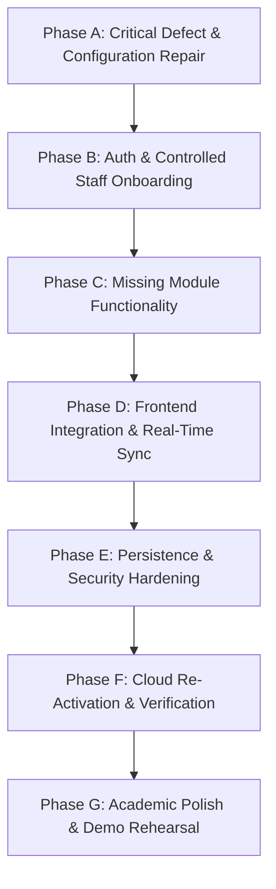

# FleetX — Comprehensive Engineering Implementation Backlog & Task Blueprint

**Document:** Phased Engineering Task Specifications & Acceptance Criteria  
**Project:** FleetX — Intelligent Fleet & Logistics Management System  
**Audit Date:** 2026-10-23  
**Status:** PROPOSED BLUEPRINT (Read-only planning; no code modified in this audit)  

---

## 1. Phased Architecture Strategy

The implementation backlog is organized into **seven sequential phases (A through G)** ordered strictly by architectural dependency. Each task provides the exact technical specification an engineer or AI assistant needs to execute the change without guessing.

---

## 2. Phase A: Critical Defect & Configuration Repair

### Task A-1: Re-activate Cloud Database Host & Render Environment
- **Task ID:** `TASK-A1-DB-REACTIVATION`
- **Priority:** CRITICAL | **Risk:** High
- **Assigned Owner:** Member 1 (Lead Systems Architect)
- **Business Reason:** The live public application (`https://fleetx-h9wf.onrender.com`) is currently timing out because the upstream Aiven MySQL host returns `NXDOMAIN`.
- **Current Observed State:** `nslookup fleetx-mysql-ziaulmustafa2005-c043.k.aivencloud.com` returns `NXDOMAIN`. Render container fails on startup.
- **Exact Current Files Involved:** `render.yaml`, `backend/src/main/resources/application-prod.yml`.
- **New File Needed?** No.
- **Missing or Incorrect Behavior:** Upstream database hostname is offline due to Aiven inactivity shutdown.
- **Exact Expected Final Behavior:** Database host is reachable via TCP port 15887 with TLS; Render container boots to `UP` status within 40 seconds.
- **Suggested Code/Configuration Changes:** Power on Aiven service in console; update `SPRING_DATASOURCE_URL` and `SPRING_DATASOURCE_PASSWORD` in Render Dashboard Environment if a new service is created.
- **Dependencies:** None.
- **Acceptance Criteria:** `nc -zv <HOST> <PORT>` succeeds; `GET https://fleetx-h9wf.onrender.com/api/health` returns HTTP 200.
- **Tests That Prove Completion:** `./smoke_test.sh "https://fleetx-h9wf.onrender.com" "admin@fleetx.local" "FleetXAdmin2026!"` passes 10/10 checks.

---

### Task A-2: Reconcile Development Password Inconsistency
- **Task ID:** `TASK-A2-DEV-PASSWORD-RECONCILIATION`
- **Priority:** MEDIUM | **Risk:** Low
- **Assigned Owner:** Member 1 (Identity & Admin)
- **Business Reason:** In `smoke_test.sh`, the default fallback admin password is set to `Admin@123`, whereas `DemoIdentitySeeder.java` seeds `DevAdmin123!`, causing confusion during local manual testing without arguments.
- **Current Observed State:** `smoke_test.sh` line 6: `ADMIN_PASS="${3:-Admin@123}"`.
- **Exact Current Files Involved:** `smoke_test.sh`, `backend/src/main/java/com/fleetx/auth/config/DemoIdentitySeeder.java`.
- **New File Needed?** No.
- **Missing or Incorrect Behavior:** Password default mismatch between smoke script and seeder.
- **Exact Expected Final Behavior:** Running `./smoke_test.sh` with zero arguments against local development server (`http://127.0.0.1:8080`) authenticates seamlessly.
- **Suggested Changes:** Align `ADMIN_PASS` in `smoke_test.sh` to `${3:-DevAdmin123!}` or document development vs production credentials clearly.
- **Dependencies:** None.
- **Acceptance Criteria:** `./smoke_test.sh` succeeds with zero CLI arguments against local backend.
- **Tests That Prove Completion:** Execute `./smoke_test.sh` with no parameters.

---

## 3. Phase B: Authentication, Account Lifecycle & Admin Model

### Task B-1: Implement Self-Service Profile Password Change
- **Task ID:** `TASK-B1-PROFILE-PASSWORD-CHANGE`
- **Priority:** HIGH | **Risk:** Medium
- **Assigned Owner:** Member 1 (Identity & Admin)
- **Business Reason:** While an administrator can override staff passwords (`/api/v1/admin/users/{id}/password-reset`), individual authenticated staff users have no endpoint to change their own password from `ProfilePage.tsx`.
- **Current Observed State:** `ProfilePage.tsx` only renders user metadata with no password change form.
- **Exact Current Files Involved:**
  - `backend/src/main/java/com/fleetx/auth/controller/AuthController.java`
  - `backend/src/main/java/com/fleetx/auth/service/AuthService.java`
  - `frontend/src/features/auth/api/authApi.ts`
  - `frontend/src/features/auth/pages/ProfilePage.tsx`
- **New File Needed?** `backend/src/main/java/com/fleetx/auth/dto/PasswordChangeRequest.java` (NEW).
- **Missing or Incorrect Behavior:** No endpoint exists for authenticated users to update their own password.
- **Exact Expected Final Behavior:** An authenticated user submits `currentPassword` and `newPassword`; backend verifies BCrypt hash of current password, encodes new password, updates `users.password_hash`, and writes `PASSWORD_CHANGE_SELF` to `audit_logs`.
- **Suggested Changes:**
  - Create `PasswordChangeRequest` record (`currentPassword`, `newPassword`).
  - Add `PUT /api/v1/auth/password` endpoint in `AuthController.java`.
  - Add `changePassword()` method in `AuthService.java`.
  - Add form and submit handler in `ProfilePage.tsx`.
- **Dependencies:** `TASK-A1-DB-REACTIVATION`.
- **Acceptance Criteria:** Correct current password updates credentials; incorrect current password returns HTTP 400 with `INVALID_CREDENTIALS`.
- **Tests That Prove Completion:** Unit test in `AuthLifecycleTest.java`; UI test in `AuthComponents.test.tsx`.

---

### Task B-2: Safeguard Last Active Administrator Account
- **Task ID:** `TASK-B2-ADMIN-LOCKOUT-SAFEGUARD`
- **Priority:** MEDIUM | **Risk:** Medium
- **Assigned Owner:** Member 1 (Identity & Admin)
- **Business Reason:** In `AdminUserService.updateUserStatus()` and `updateUser()`, an administrator can theoretically deactivate their own account or remove the `ROLE_ADMIN` role, leaving the system with zero active administrators.
- **Current Observed State:** `AdminUserService.java` checks `if (user.getEmail().equalsIgnoreCase(currentAdminEmail))` for deactivation, but does not verify whether other active admins exist when changing roles.
- **Exact Current Files Involved:** `backend/src/main/java/com/fleetx/auth/service/AdminUserService.java`.
- **New File Needed?** No.
- **Missing or Incorrect Behavior:** Last remaining admin can have their role downgraded.
- **Exact Expected Final Behavior:** Attempting to deactivate or remove `ROLE_ADMIN` from the sole remaining active admin throws `DomainException(HttpStatus.CONFLICT, "CANNOT_DEMOTE_LAST_ADMIN")`.
- **Suggested Changes:** Query `userRepository.countActiveAdmins()` before applying role mutation or deactivation.
- **Dependencies:** None.
- **Acceptance Criteria:** Demoting the last admin is rejected with HTTP 409 Conflict.
- **Tests That Prove Completion:** Test case in `AdminUserOperationsTest.java`.

---

## 4. Phase C: Missing Module Business Functionality

### Task C-1: Vehicle Soft-Deletion / Retirement Safeguard
- **Task ID:** `TASK-C1-VEHICLE-RETIREMENT-GUARD`
- **Priority:** MEDIUM | **Risk:** Low
- **Assigned Owner:** Member 2 (Fleet & Asset Management)
- **Business Reason:** Vehicles currently support `RETIRED` status, but the system allows retiring a vehicle that is currently assigned to an active in-progress trip.
- **Current Observed State:** `VehicleService.updateVehicleStatus()` sets status without checking whether `tripLookupService.isVehicleAssignedToActiveTrip(id)` is true.
- **Exact Current Files Involved:**
  - `backend/src/main/java/com/fleetx/fleet/service/VehicleService.java`
  - `backend/src/main/java/com/fleetx/shared/contract/TripLookupService.java`
- **New File Needed?** No.
- **Missing or Incorrect Behavior:** Vehicle can be retired or put into maintenance while `IN_TRIP`.
- **Exact Expected Final Behavior:** If `TripLookupService` reports an active trip, attempting to set status to `MAINTENANCE` or `RETIRED` throws `InvalidStateTransitionException` with message `"Vehicle is currently assigned to active trip and cannot be transitioned to MAINTENANCE/RETIRED"`.
- **Suggested Changes:** Consult `tripLookupService` before persisting status mutation in `VehicleService.java`.
- **Dependencies:** None.
- **Acceptance Criteria:** Rejection with HTTP 400 when vehicle has an active trip.
- **Tests That Prove Completion:** Test case in `VehicleOperationsTest.java`.

---

### Task C-2: Automated Driver Trip Hours / Rest Period Enforcement
- **Task ID:** `TASK-C2-DRIVER-HOURS-COMPLIANCE`
- **Priority:** LOW | **Risk:** Low
- **Assigned Owner:** Member 3 (Commercial Drivers & Trips)
- **Business Reason:** Road safety compliance mandates maximum continuous driving hours.
- **Current Observed State:** `TripService.createTrip()` checks driver licence expiry and availability, but does not check rest hours since last completed trip.
- **Exact Current Files Involved:** `backend/src/main/java/com/fleetx/drivers/service/TripService.java`.
- **New File Needed?** No.
- **Missing or Incorrect Behavior:** Driver can be dispatched immediately after completing a 12-hour trip without rest period.
- **Exact Expected Final Behavior:** If last completed trip ended less than 8 hours before scheduled start, dispatcher receives a compliance warning.
- **Suggested Changes:** Add optional rest hours calculation in `DriverService.isDriverEligibleForTrip()`.
- **Dependencies:** None.
- **Acceptance Criteria:** Driver eligibility returns warning or false if rest interval is violated.
- **Tests That Prove Completion:** Test case in `DriverOperationsTest.java`.

---

### Task C-3: Geofence Polygonal Coordinate GeoJSON Exporter
- **Task ID:** `TASK-C3-GEOFENCE-GEOJSON-EXPORT`
- **Priority:** LOW | **Risk:** Low
- **Assigned Owner:** Member 5 (Tracking & Control Tower)
- **Business Reason:** Polygonal geofences are stored in MySQL as JSON strings in `polygon_coordinates_json`. External GIS tools expect standard GeoJSON format.
- **Current Observed State:** `GeofenceResponseDto` returns raw string coordinates.
- **Exact Current Files Involved:**
  - `backend/src/main/java/com/fleetx/tracking/dto/GeofenceResponseDto.java`
  - `backend/src/main/java/com/fleetx/tracking/service/TrackingService.java`
- **New File Needed?** No.
- **Missing or Incorrect Behavior:** GeoJSON feature collection format not natively formatted in response.
- **Exact Expected Final Behavior:** Add parsed GeoJSON structure to DTO for Leaflet polygon layer.
- **Suggested Changes:** Parse coordinate JSON into `List<List<Double>>` in `GeofenceResponseDto`.
- **Dependencies:** None.
- **Acceptance Criteria:** Valid GeoJSON coordinates delivered to frontend.
- **Tests That Prove Completion:** Unit test in `SimulationAndGeofenceTest.java`.

---

## 5. Phase D: Real-Time Telemetry & STOMP Push Integration

### Task D-1: Wire Native STOMP WebSocket Client in Frontend Control Tower
- **Task ID:** `TASK-D1-STOMP-WEBSOCKET-CLIENT`
- **Priority:** HIGH | **Risk:** Medium
- **Assigned Owner:** Member 5 (Tracking & Control Tower)
- **Business Reason:** The presentation and paper claim that the control tower receives live telemetry pushed over STOMP WebSockets (`/ws/fleetx`). In reality, `ControlTowerPage.tsx` currently polls REST every 3 seconds.
- **Current Observed State:** `ControlTowerPage.tsx` lines 110-118 uses `setInterval(loadControlTowerData, 3000)`.
- **Exact Current Files Involved:**
  - `frontend/package.json`
  - `frontend/src/features/tracking/pages/ControlTowerPage.tsx`
  - `frontend/src/features/tracking/components/LeafletFleetMap.tsx`
- **New File Needed?** `frontend/src/shared/api/stompClient.ts` (NEW).
- **Missing or Incorrect Behavior:** Real-time push communication is not utilized by the frontend UI.
- **Exact Expected Final Behavior:** Frontend subscribes to `/topic/vehicles/{id}` and `/topic/fleet-locations` via SockJS/STOMP. Telemetry markers on Leaflet map update instantly on tick without HTTP polling.
- **Suggested Changes:**
  - Add `@stomp/stompjs` and `sockjs-client` to `frontend/package.json`.
  - Create reusable STOMP subscription hook `useStompTelemetry()`.
  - Fall back to 5-second polling only if WebSocket connection fails.
- **Dependencies:** None.
- **Acceptance Criteria:** Telemetry updates occur via WebSocket frame; map markers move smoothly in real time.
- **Tests That Prove Completion:** Test case in `TrackingComponents.test.tsx` verifying STOMP connection.

---

## 6. Phase E: Persistence Verification & Security Hardening

### Task E-1: Automated Docker MySQL 8.4 Integration Test Runner
- **Task ID:** `TASK-E1-MYSQL-INTEGRATION-TEST-AUTOMATION`
- **Priority:** MEDIUM | **Risk:** Low
- **Assigned Owner:** Member 1 & Member 2
- **Business Reason:** 4 tests in `MySQL8PersistenceIntegrationTest.java` are skipped when Docker MySQL on port 3307 is not active.
- **Current Observed State:** Surefire reports: `Tests run: 88, Failures: 0, Errors: 0, Skipped: 4`.
- **Exact Current Files Involved:** `backend/src/test/java/com/fleetx/integration/MySQL8PersistenceIntegrationTest.java`, `docker-compose.yml`.
- **New File Needed?** No.
- **Missing or Incorrect Behavior:** Automated CI does not start Docker Compose before running Maven test.
- **Exact Expected Final Behavior:** Running test script starts MySQL 8.4 container, runs surefire tests with 88/88 passed (0 skipped), and shuts down container.
- **Suggested Changes:** Provide helper script `run_mysql_persistence_tests.sh`.
- **Dependencies:** Docker daemon.
- **Acceptance Criteria:** `MySQL8PersistenceIntegrationTest` executes and passes all 4 persistence checks.
- **Tests That Prove Completion:** Execute `./mvnw test -Dspring.profiles.active=qa`.

---

## 7. Phase F: Cloud Deployment Re-Activation & Public Verification

### Task F-1: Full Public Smoke Test & SSL Verification
- **Task ID:** `TASK-F1-PUBLIC-SMOKE-VERIFICATION`
- **Priority:** CRITICAL | **Risk:** Medium
- **Assigned Owner:** Member 1 (Lead Systems Architect)
- **Business Reason:** Provide verifiable proof that the cloud application is live and accessible for evaluation.
- **Current Observed State:** Render service waiting for database reactivation.
- **Exact Current Files Involved:** `smoke_test.sh`, `verify_mysql_persistence.py`.
- **New File Needed?** No.
- **Missing or Incorrect Behavior:** None once `TASK-A1` is executed.
- **Exact Expected Final Behavior:** All 10 smoke checks return PASS (HTTP 200/401).
- **Suggested Changes:** Run `./smoke_test.sh "https://fleetx-h9wf.onrender.com" "admin@fleetx.local" "<PASSWORD>"`.
- **Dependencies:** `TASK-A1-DB-REACTIVATION`.
- **Acceptance Criteria:** 10/10 smoke test assertions pass.
- **Tests That Prove Completion:** Execute `smoke_test.sh`.

---

## 8. Phase G: Academic Polish & Demonstration Rehearsal

### Task G-1: Seed Data Review & Demonstration Walkthrough Script
- **Task ID:** `TASK-G1-DEMO-SCRIPT-PREPARATION`
- **Priority:** HIGH | **Risk:** Low
- **Assigned Owner:** All 5 Team Members
- **Business Reason:** The 5-member team must demonstrate their respective modules seamlessly to faculty evaluators.
- **Current Observed State:** Demo seeders exist in code (`dev` profile), but no unified step-by-step oral demonstration script is rehearsed.
- **Exact Current Files Involved:** `docs/README.md`, `FleetX_Project_Presentation_Slides.pdf`.
- **New File Needed?** `docs/DEMONSTRATION_WALKTHROUGH_SCRIPT.md` (NEW).
- **Missing or Incorrect Behavior:** Risk of disjointed presentation during the college evaluation.
- **Exact Expected Final Behavior:** Each student executes their assigned 2-minute workflow proving genuine database-backed functionality.
- **Dependencies:** All previous tasks.
- **Acceptance Criteria:** Successful dry-run demonstration completed by all 5 members within 10 minutes.
- **Tests That Prove Completion:** Faculty viva rehearsal.
