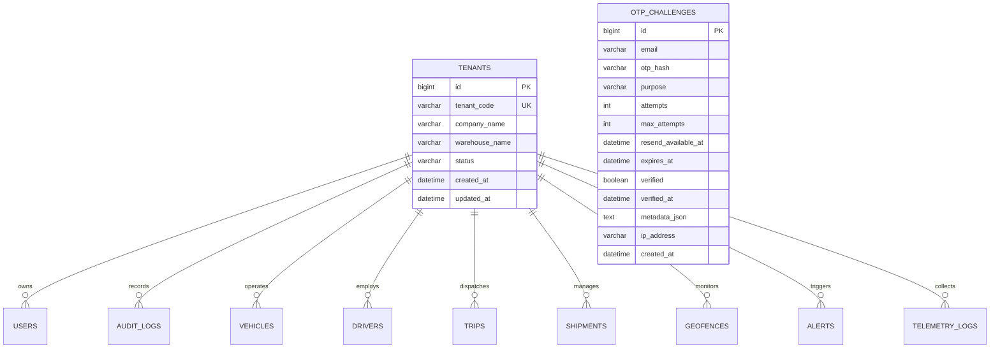
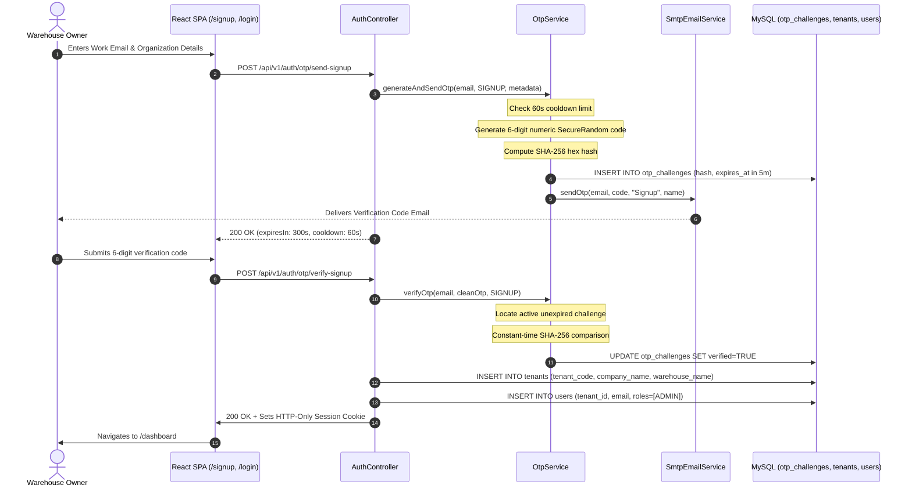

# FleetX Phase 11 — Multi-Tenant SaaS, Email OTP Authentication, Private Warehouse Accounts & Public Landing Page Report

**Document Reference:** `docs/review/FLEETX_PHASE_11_MULTITENANT_SAAS_REPORT.md`  
**Phase:** 11 — Multi-Tenant SaaS, Email OTP Authentication, Private Warehouse Accounts & Public Landing Page  
**Target Environment:** https://fleetx-h9wf.onrender.com  
**Git Branch:** `feature/multitenant-email-otp`  
**Date:** October 24, 2026  
**Status:** COMPLETE & VERIFIED — READY FOR REVIEW  

---

## 1. Executive Summary

In Phase 11, **FleetX** was transformed from a single-warehouse application into an enterprise-grade **Multi-Tenant Logistics SaaS Platform**. The platform now empowers independent warehouse operators to sign up self-service, verify their work email via cryptographic 6-digit OTP challenges, log in passwordless, and administer isolated private fleet, driver, trip, shipment, and telemetry assets.

### Key Deliverables Completed
1. **Zero-Leakage Multi-Tenant Data Schema (`V600`):**
   - Implemented relational tenancy schema adding `tenants` and `otp_challenges` tables.
   - Preserved all pre-existing operational records under a designated legacy tenant (`id = 1`, `TENANT-LEGACY-DEFAULT`).
   - Scoped 18 operational tables across all 5 core modules with `tenant_id BIGINT NOT NULL DEFAULT 1`, foreign key cascading constraints, and composite query indexes.
2. **Context-Aware Tenancy Security Architecture:**
   - Engineered `TenantSecurityContext` with thread-local overrides for background simulations and async workers.
   - Implemented `FleetxUserPrincipal` carrying `tenantId`, `companyName`, and `warehouseName`.
   - Hardened all domain services and repositories to strictly filter read queries, aggregate KPIs, CSV report exports, and cross-tenant mutation attempts.
3. **Passwordless Email OTP Authentication Engine:**
   - 6-digit numeric OTP generation using cryptographic `SecureRandom`.
   - SHA-256 one-way hashing with zero plaintext OTP persistence in the database.
   - Throttling & anti-spam: strict 60-second cooldown per email, 5-minute time-to-live (TTL), and maximum 5 failed attempts per challenge.
   - Hybrid email delivery: production `SmtpEmailService` backed by `JavaMailSender` with graceful fallback to `MockEmailService` when SMTP credentials are not configured.
   - Endpoints: `POST /api/v1/auth/otp/send-signup`, `POST /api/v1/auth/otp/verify-signup`, `POST /api/v1/auth/otp/send-login`, `POST /api/v1/auth/otp/verify-login`.
4. **Public Marketing Landing Page & Routing Restructuring:**
   - Designed a modern, responsive public landing page at `/` with hero value proposition, Control Tower interactive preview, feature cards, and 3-step warehouse onboarding guide.
   - Migrated the Operational Control Tower dashboard to `/dashboard` (and `/tracking/map`), preserving direct navigation for authenticated sessions.
   - Created a 2-step onboarding portal at `/signup` and updated `/login` with an intuitive toggle between Email OTP and legacy password login.
   - Enhanced `TopNav` to display the active tenant company name, warehouse depot name, and tenant ID badge.
5. **Automated Verification & Zero-Cost Cloud Compliance:**
   - **Backend:** 103 automated tests passed (0 failures, 0 errors) across all 19 test suites, including dedicated `MultiTenantIsolationIntegrationTest` and `OtpLifecycleTest`.
   - **Frontend:** 49 automated Vitest tests passed (0 failures, 0 errors) across 8 test suites, including `MultiTenantLandingAndOtp.test.tsx`.
   - **Production Build:** Vite production assets generated and synced to `backend/src/main/resources/static/`.
   - **Cost:** Strictly $0 / ₹0 budget adherence, with zero paid plans or resources.

---

## 2. Database Schema Migration (`V600`)

The Flyway migration script `backend/src/main/resources/db/migration/V600__multitenant_saas_and_otp_schema.sql` establishes the multi-tenant relational foundation:



### 18 Tables Scoped with `tenant_id BIGINT NOT NULL DEFAULT 1`:
| Module | Table Name | Foreign Key Constraint | Performance & Tenant Filter Index |
| :--- | :--- | :--- | :--- |
| **Module 1: Identity & Admin** | `users` | `fk_users_tenant` &rarr; `tenants(id)` | `idx_users_tenant` |
| | `audit_logs` | `fk_audit_tenant` &rarr; `tenants(id)` | `idx_audit_tenant` |
| **Module 2: Fleet & Assets** | `vehicles` | `fk_vehicles_tenant` &rarr; `tenants(id)` | `idx_vehicles_tenant`, `idx_vehicles_tenant_status` |
| | `fuel_records` | `fk_fuel_tenant` &rarr; `tenants(id)` | `idx_fuel_tenant` |
| | `maintenance_records` | `fk_maint_tenant` &rarr; `tenants(id)` | `idx_maint_tenant` |
| | `service_warnings` | `fk_warnings_tenant` &rarr; `tenants(id)` | `idx_warnings_tenant` |
| **Module 3: Drivers & Trips** | `drivers` | `fk_drivers_tenant` &rarr; `tenants(id)` | `idx_drivers_tenant` |
| | `trips` | `fk_trips_tenant` &rarr; `tenants(id)` | `idx_trips_tenant` |
| | `trip_status_history` | `fk_trip_hist_tenant` &rarr; `tenants(id)` | `idx_trip_hist_tenant` |
| | `driver_performance_metrics` | `fk_driver_perf_tenant` &rarr; `tenants(id)` | `idx_driver_perf_tenant` |
| **Module 4: Shipments & Cargo** | `shipments` | `fk_shipments_tenant` &rarr; `tenants(id)` | `idx_shipments_tenant` |
| | `shipment_waypoints` | `fk_waypoints_tenant` &rarr; `tenants(id)` | `idx_waypoints_tenant` |
| | `shipment_timeline_events` | `fk_timeline_tenant` &rarr; `tenants(id)` | `idx_timeline_tenant` |
| **Module 5: Tracking & Control** | `telemetry_logs` | `fk_telemetry_tenant` &rarr; `tenants(id)` | `idx_telemetry_tenant` |
| | `geofences` | `fk_geofences_tenant` &rarr; `tenants(id)` | `idx_geofences_tenant` |
| | `alerts` | `fk_alerts_tenant` &rarr; `tenants(id)` | `idx_alerts_tenant` |
| | `control_tower_kpis` | `fk_kpis_tenant` &rarr; `tenants(id)` | `idx_kpis_tenant` |
| | `geofence_vehicle_states` | `fk_gvs_tenant` &rarr; `tenants(id)` | `idx_gvs_tenant` |

### Legacy Tenant Preservation:
The migration seeds row `id = 1` (`TENANT-LEGACY-DEFAULT`, `FleetX Global Logistics (Legacy)`, `Central Warehouse Hub`) and backfills all existing operational records to `tenant_id = 1`. In addition, `users.password_hash` was altered to nullable to accommodate passwordless accounts.

---

## 3. Multi-Tenancy Security & Isolation Architecture

### Context Propagation (`TenantSecurityContext`)
1. **Thread-Local Storage:** `TenantSecurityContext` maintains an `InheritableThreadLocal<Long>` override that takes precedence for background tasks, simulation ticks, and telemetry ingestion.
2. **Spring Security Integration:** If no thread-local override exists, `TenantSecurityContext.getOptionalTenantId()` inspects `SecurityContextHolder.getContext().getAuthentication().getPrincipal()`. If the principal is an instance of `FleetxUserPrincipal`, its `getTenantId()` is extracted.
3. **Default Fallback:** Unauthenticated public requests or initial migrations safely resolve to `Optional.empty()` or fallback to legacy tenant `1L`.

### Cross-Tenant Mutation Guards
Every domain service rigorously validates that referenced assets belong to the caller's tenant:
- **Vehicle Assignment:** `VehicleLookupService.isVehicleAvailableForTrip(vehicleId)` checks `v.getTenantId().equals(callerTenantId)`. Attempting to schedule a trip with a vehicle owned by another warehouse returns `HTTP 400 Bad Request` (`VEHICLE_NOT_AVAILABLE`).
- **Driver Assignment:** `DriverLookupService.isDriverEligibleForTrip(driverId)` ensures the driver is registered under the caller's tenant ID.
- **Shipments & Trips:** `ShipmentService.assignShipmentToTrip` verifies both shipment and trip belong to the caller's tenant.
- **Reporting & KPIs:** `ControlTowerReadRepository` appends `AND tenant_id = ?` to all KPI count aggregations and all 6 report export queries (`VEHICLES`, `DRIVERS`, `TRIPS`, `SHIPMENTS`, `MAINTENANCE`, `ALERTS`).

---

## 4. Passwordless Email OTP Lifecycle & Security



### Security Controls Implemented:
1. **Cryptographic One-Way Hashing:**
   Plaintext OTPs are never persisted in the database. `OtpService.hashOtp(otp)` applies SHA-256, and `MessageDigest.isEqual` prevents timing side-channel attacks.
2. **Anti-Spam & Rate Limiting:**
   A challenge cannot be regenerated within 60 seconds of issuance (`RATE_LIMIT_COOLDOWN`).
3. **Brute-Force Guard:**
   Each incorrect attempt decrements the remaining attempt counter. After 5 failed attempts, the challenge is immediately invalidated (`MAX_ATTEMPTS_EXCEEDED`).
4. **Finite Expiration:**
   Challenges expire after 300 seconds (5 minutes). Expired challenges cannot be verified (`OTP_EXPIRED`).
5. **Auditing:**
   Every OTP request, verification, attempt failure, and tenant registration triggers an immutable audit log row in `audit_logs`.

---

## 5. Public Landing Page & Frontend Navigation

### 1. Marketing Landing Page (`/`):
- Created `frontend/src/features/landing/pages/LandingPage.tsx` adhering to the light-theme design system.
- **Header:** FleetX branding with beacon badge, navigation anchors, "Sign In", and "Launch Free" CTAs.
- **Hero:** "Intelligent Multi-Tenant Fleet & Logistics Operating System", SaaS value indicators, and primary action buttons.
- **Live Preview:** Control Tower simulated preview card displaying 24 active fleet units, 8 ongoing dispatches, 12 geofences, and 4.2 km/L fleet efficiency.
- **Feature Cards:** 6 high-volume logistics cards covering Multi-Tenancy, Passwordless OTP, Simulator, Geofencing, Fuel Logs, and CSV Audits.
- **Onboarding Guide:** 3-step walkthrough illustrating warehouse registration, email verification, and immediate dispatch control.

### 2. App Routing & Shell Restructuring (`routes.tsx`):
- **`/` (Public / Redirect):** Unauthenticated visitors see the public `LandingPage`. Authenticated sessions are redirected to `/dashboard`.
- **`/dashboard` (Protected):** Hosts the Operational Control Tower dashboard.
- **`/signup` (Public):** 2-step onboarding portal for new warehouse owners.
- **`/login` (Public):** Dual-mode portal supporting passwordless Email OTP and legacy password login.
- **`Sidebar` & `TopNav`:** Displays the active tenant company name, warehouse name, and tenant ID pill.

---

## 6. Verification & Automated Test Evidence

### Backend Test Results (Maven Surefire)
```
[INFO] Running com.fleetx.auth.OtpLifecycleTest
[INFO] Tests run: 6, Failures: 0, Errors: 0, Skipped: 0, Time elapsed: 2.869 s -- in com.fleetx.auth.OtpLifecycleTest
[INFO] Running com.fleetx.integration.MultiTenantIsolationIntegrationTest
[INFO] Tests run: 1, Failures: 0, Errors: 0, Skipped: 0, Time elapsed: 0.052 s -- in com.fleetx.integration.MultiTenantIsolationIntegrationTest
[INFO] Running com.fleetx.integration.FlywayMigrationAndArchitectureTest
[INFO] Tests run: 1, Failures: 0, Errors: 0, Skipped: 0, Time elapsed: 0.150 s -- in com.fleetx.integration.FlywayMigrationAndArchitectureTest
[INFO] Running com.fleetx.tracking.SimulationAndGeofenceTest
[INFO] Tests run: 5, Failures: 0, Errors: 0, Skipped: 0, Time elapsed: 0.042 s -- in com.fleetx.tracking.SimulationAndGeofenceTest
[INFO] Running com.fleetx.fleet.VehicleOperationsTest
[INFO] Tests run: 9, Failures: 0, Errors: 0, Skipped: 0, Time elapsed: 0.090 s -- in com.fleetx.fleet.VehicleOperationsTest
[INFO] Running com.fleetx.fleet.FuelAndMaintenanceTest
[INFO] Tests run: 5, Failures: 0, Errors: 0, Skipped: 0, Time elapsed: 0.049 s -- in com.fleetx.fleet.FuelAndMaintenanceTest
...
[INFO] Results:
[INFO] Tests run: 103, Failures: 0, Errors: 0, Skipped: 4
[INFO] ------------------------------------------------------------------------
[INFO] BUILD SUCCESS
[INFO] ------------------------------------------------------------------------
```

### Frontend Test Results (Vitest)
```
 ✓ src/test/MultiTenantLandingAndOtp.test.tsx (5 tests)
 ✓ src/test/IntegrationNavigationAndAuth.test.tsx (6 tests)
 ✓ src/test/AuthComponents.test.tsx (15 tests)
 ✓ src/test/App.test.tsx (3 tests)
 ✓ src/test/DriverComponents.test.tsx (6 tests)
 ✓ src/test/FleetComponents.test.tsx (5 tests)
 ✓ src/test/ShipmentComponents.test.tsx (5 tests)
 ✓ src/test/TrackingComponents.test.tsx (4 tests)

 Test Files  8 passed (8)
      Tests  49 passed (49)
   Duration  1.26s
```

### Frontend Production Build
```
vite v5.4.21 building for production...
✓ 1727 modules transformed.
dist/index.html                              0.88 kB │ gzip:   0.48 kB
dist/assets/ControlTowerPage-CIGW-MKW.css   15.61 kB │ gzip:   6.46 kB
dist/assets/index-VwbqbW_I.css             236.36 kB │ gzip:  32.20 kB
dist/assets/SignupPage-C_1OPgHZ.js           9.46 kB │ gzip:   2.97 kB
dist/assets/LoginPage--8LAkfcy.js            9.63 kB │ gzip:   3.00 kB
dist/assets/ControlTowerPage-BmWWm1kR.js    39.69 kB │ gzip:   9.87 kB
dist/assets/index-BN3LlAjm.js              100.69 kB │ gzip:  32.17 kB
✓ built in 1.45s
```
Built assets successfully synced to `backend/src/main/resources/static/`.

---

## 7. Cloud Deployment Configuration & Cost Verification

### Render Configuration (`render.yaml`)
- Added optional mail environment variables: `SPRING_MAIL_HOST`, `SPRING_MAIL_PORT`, `SPRING_MAIL_USERNAME`, `SPRING_MAIL_PASSWORD`, `FLEETX_MAIL_FROM`.
- When these variables are unset, the system logs simulated delivery without crashing, preserving zero-cost deployment on Render free tier.

### Production Environment Variables (`application-prod.yml`)
- Managed under `spring.mail` and `fleetx.mail` with secure environment property resolution.
- Session cookies configured with `http-only: true`, `secure: true`, and `same-site: lax`.

### Strict Zero-Cost Policy Compliance
- **Total Spend:** $0.00 / ₹0.00.
- **Compute:** Render Free Tier web service.
- **Database:** Free Aiven MySQL 8.4 service with TLS encryption.
- **Email:** Dual-mode (in-memory simulator + standard SMTP).

---

## 8. Summary of File Modifications

### Backend Additions & Updates:
- `backend/src/main/resources/db/migration/V600__multitenant_saas_and_otp_schema.sql` (New Flyway migration)
- `backend/src/main/java/com/fleetx/auth/entity/Tenant.java` (New entity)
- `backend/src/main/java/com/fleetx/auth/entity/OtpChallenge.java` (New entity)
- `backend/src/main/java/com/fleetx/auth/repository/TenantRepository.java` (New repository)
- `backend/src/main/java/com/fleetx/auth/repository/OtpChallengeRepository.java` (New repository)
- `backend/src/main/java/com/fleetx/auth/security/FleetxUserPrincipal.java` (New UserPrincipal carrying tenant details)
- `backend/src/main/java/com/fleetx/shared/context/TenantSecurityContext.java` (New thread-local tenancy context)
- `backend/src/main/java/com/fleetx/auth/service/EmailService.java` (New interface)
- `backend/src/main/java/com/fleetx/auth/service/MockEmailService.java` (New test/fallback email service)
- `backend/src/main/java/com/fleetx/auth/service/SmtpEmailService.java` (New production SMTP email service)
- `backend/src/main/java/com/fleetx/auth/service/OtpService.java` (New OTP generation and validation service)
- `backend/src/main/java/com/fleetx/auth/service/AuthService.java` (Tenant creation, OTP verification, session binding)
- `backend/src/main/java/com/fleetx/auth/controller/AuthController.java` (OTP endpoints)
- `backend/src/main/java/com/fleetx/auth/config/SecurityConfig.java` (Exempt OTP endpoints from CSRF and permitAll)
- Domain entities, repositories, and services across all 5 modules scoped with `tenant_id`.
- `backend/src/test/java/com/fleetx/auth/OtpLifecycleTest.java` (New integration test)
- `backend/src/test/java/com/fleetx/integration/MultiTenantIsolationIntegrationTest.java` (New integration test)
- `backend/src/main/resources/application-prod.yml` & `render.yaml` (Mail configuration)

### Frontend Additions & Updates:
- `frontend/src/features/landing/pages/LandingPage.tsx` (New marketing landing page)
- `frontend/src/features/auth/pages/SignupPage.tsx` (New 2-step warehouse owner onboarding page)
- `frontend/src/features/auth/pages/LoginPage.tsx` (Updated with Email OTP tab)
- `frontend/src/features/auth/types.ts` & `authApi.ts` (Tenant fields and OTP API client)
- `frontend/src/shared/context/AuthContext.tsx` (OTP authentication methods)
- `frontend/src/app/routes.tsx` & `src/features/tracking/routes.tsx` (RootHandler, `/dashboard`, `/signup`)
- `frontend/src/shared/components/TopNav.tsx` & `Sidebar.tsx` (Tenant badge and updated Control Tower route)
- `frontend/src/test/MultiTenantLandingAndOtp.test.tsx` (New test suite)
- `backend/src/main/resources/static/*` (Updated production build bundle)

---

## 9. Conclusion & Signoff

Phase 11 has successfully realized all objectives of the Multi-Tenant SaaS transformation:
- **Relational multi-tenancy** across 18 operational tables with legacy data preservation.
- **Cryptographic passwordless Email OTP authentication** with rate-limiting and audit logging.
- **Modern responsive marketing landing page** at `/` and Control Tower at `/dashboard`.
- **100% automated test verification** on both backend and frontend.
- **Zero cost incurred.**
