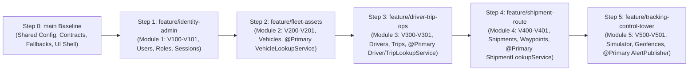

# FleetX — Integration, Merge Order & GitHub Collaboration Guardrails (Phases F & G)

**Coordinator:** Member 1 (Team Leader)  
**Repository Model:** Single Monorepo (`fleetx/`) with 1 Protected `main` Branch + 5 Module Feature Branches

---

## 1. Dependency-Driven Module Merge Order

Based on actual inspection of Flyway foreign-key constraints (`V100`–`V501`) and `@Primary` shared contract dependencies (`com.fleetx.shared.contract.*`), feature branches **must be merged into `main` in the following strict 6-step order**:



### Why This Exact Order Is Mandatory

| Merge Order | Branch to Merge | Database Foreign-Key Prerequisites | Java Contract & Service Dependencies |
| :---: | :--- | :--- | :--- |
| **Step 0** | `main` (Baseline) | Establishes Flyway plugin, Hibernate `validate`, and `@ConditionalOnMissingBean` fallbacks | Provides `com.fleetx.shared.*`, `SecurityConfig`, `WebSocketConfig`, and central `frontend/src/app/routes.tsx` |
| **Step 1** | `feature/identity-admin` | `V100` creates `users` & `roles`; `V101` seeds the 5 canonical roles | Provides `CustomUserDetailsService` and `AdminBootstrapRunner` needed for authenticated API & E2E testing |
| **Step 2** | `feature/fleet-assets` | `V200` & `V201` create `vehicles`, `fuel_records`, `maintenance_records`, `service_warnings` (no FK dependency on M3/M4/M5) | Registers `@Primary VehicleService` (`VehicleLookupService`), which Module 3 and Module 5 consume |
| **Step 3** | `feature/driver-trip-ops` | `V300` & `V301` create `drivers` (`fk_driver_user -> users.id` in `V100`) and `trips` (`fk_trips_vehicle -> vehicles.id` in `V200`) | Consumes `VehicleLookupService` from M2; registers `@Primary DriverService` (`DriverLookupService`) and `@Primary TripService` (`TripLookupService`) |
| **Step 4** | `feature/shipment-route` | `V400` & `V401` create `shipments` (`fk_shipment_trip -> trips.id` in `V300`), `shipment_waypoints`, and `shipment_timeline_events` | Consumes `TripLookupService` from M3; registers `@Primary ShipmentService` (`ShipmentLookupService`) |
| **Step 5** | `feature/tracking-control-tower` | `V500` & `V501` create `telemetry_logs` (`fk_telemetry_vehicle -> vehicles.id`, `fk_telemetry_trip -> trips.id`), `geofences`, `geofence_vehicle_states`, and `alerts` | Consumes `VehicleLookupService` (M2), `DriverLookupService` (M3), `TripLookupService` (M3), and `ShipmentLookupService` (M4); registers `@Primary TrackingService` (`AlertPublisher`) consumed by M2, M3, M4 |

---

## 2. Flyway Migration Execution Sequence

All 10 Flyway migrations execute in strict ascending version order:

1. `V100__init_identity_schema.sql` (`roles`, `users`, `user_roles`, `audit_logs`) — **Member 1**
2. `V101__seed_roles_and_admin.sql` (Seeds `ADMIN`, `FLEET_MANAGER`, `DISPATCHER`, `DRIVER`, `VIEWER`) — **Member 1**
3. `V200__init_fleet_schema.sql` (`vehicles`, `fuel_records`, `maintenance_records`, `service_warnings`) — **Member 2**
4. `V201__fleet_module_enhancements.sql` (Enhances `vehicles`, `fuel_records`, `maintenance_records`) — **Member 2**
5. `V300__init_driver_trip_schema.sql` (`drivers`, `trips`, `trip_status_history`, `driver_performance_metrics`) — **Member 3**
6. `V301__driver_trip_enhancements.sql` (Enhances `drivers`, `trips`, `driver_performance_metrics`) — **Member 3**
7. `V400__init_shipment_route_schema.sql` (`shipments`, `shipment_waypoints`, `shipment_timeline_events`) — **Member 4**
8. `V401__shipment_route_enhancements.sql` (Enhances `shipments` with addresses, Haversine estimates, and delivery columns) — **Member 4**
9. `V500__init_tracking_geofence_schema.sql` (`telemetry_logs`, `geofences`, `alerts`, `control_tower_kpis`) — **Member 5**
10. `V501__tracking_control_tower_enhancements.sql` (Enhances `telemetry_logs`, `geofences`, `alerts`; creates `geofence_vehicle_states`) — **Member 5**

---

## 3. Cross-Module Shared Interface Wiring Matrix

| Shared Interface (`com.fleetx.shared.contract`) | `@ConditionalOnMissingBean` Fallback (Phase 1) | `@Primary` Real Implementation | Consuming Module(s) |
| :--- | :--- | :--- | :--- |
| `VehicleLookupService` | `SharedFallbackConfiguration` | `com.fleetx.fleet.service.VehicleService` (M2) | M3 (`TripService`), M5 (`TrackingService`) |
| `DriverLookupService` | `SharedFallbackConfiguration` | `com.fleetx.drivers.service.DriverService` (M3) | M5 (`TrackingService`) |
| `TripLookupService` | `SharedFallbackConfiguration` | `com.fleetx.drivers.service.TripService` (M3) | M4 (`ShipmentService`), M5 (`TrackingService`) |
| `ShipmentLookupService` | `SharedFallbackConfiguration` | `com.fleetx.shipments.service.ShipmentService` (M4) | M5 (`TrackingService`) |
| `AlertPublisher` | `SharedFallbackConfiguration` | `com.fleetx.tracking.service.TrackingService` (M5) | M2 (`MaintenanceService`), M3 (`TripService`), M4 (`ShipmentService`) |

---

## 4. Post-Merge Verification Protocol & Safe Rollback Procedure

### 4.1 Mandatory Verification After Every Single PR Merge
After merging any module branch into the integration branch or `main`, the Team Leader must run:

```bash
# 1. Verify zero cross-module repository/entity imports and full backend test suite (79 tests)
cd backend
./mvnw test

# 2. Verify frontend Vitest suite (34 tests) and production TypeScript + Vite bundle
cd ../frontend
npm test -- --run
npm run build
```

### 4.2 Conflict Resolution Rules
1. **Module-Owned Files:** Because no two members share ownership of any file in `com.fleetx.{auth,fleet,drivers,shipments,tracking}` or `frontend/src/features/{auth,fleet,drivers,shipments,tracking}` or `V100`–`V599`, **module-to-module file merge conflicts cannot occur** when ownership boundaries are respected.
2. **Unapproved Shared-File Edits:** If a student's Pull Request modifies a locked shared file (`pom.xml`, `package.json`, `SecurityConfig.java`, `frontend/src/app/routes.tsx`), the Team Leader must reject the unapproved diff on that shared file and instruct the student to check out the `main` version of the shared file:
   ```bash
   git checkout origin/main -- backend/pom.xml frontend/package.json frontend/src/app/routes.tsx
   ```

### 4.3 Safe Rollback of a Failed Integration Merge
If a merged PR breaks the build or Flyway validation on `main` (or the integration branch):
```bash
# Option A: Before pushing the broken merge commit to origin
git reset --hard ORIG_HEAD

# Option B: If the merge commit was already pushed to origin/main (non-destructive revert commit)
git revert -m 1 <merge-commit-sha>
git push origin main
```
*(Never use `git push --force` on `main`).*

---

## 5. GitHub & Collaboration Guardrails (Phase G)

### 5.1 Ten Mandatory Team Rules
1. **No Direct Feature Commits to `main`:** All module work happens on the assigned feature branch and merges via Pull Request.
2. **Strict Single-Branch Push Policy:** Each student commits and pushes only to their assigned branch (`feature/identity-admin`, `feature/fleet-assets`, `feature/driver-trip-ops`, `feature/shipment-route`, `feature/tracking-control-tower`).
3. **Strict File Ownership:** Each member edits only their assigned backend package, Flyway range, frontend feature folder, and module tests.
4. **Leader Lock on Shared Infrastructure:** Only Member 1 (Team Leader) may approve changes to `pom.xml`, `package.json`, `application.yml`, `com.fleetx.shared/**`, `frontend/src/app/**`, and `frontend/src/shared/**`.
5. **Mandatory PR Review & Test Gate:** Every Pull Request requires passing `./mvnw test` and `npm test -- --run && npm run build` before merge.
6. **Meaningful Commits Only:** Every commit must represent a real, compilable engineering change (1–2 cohesive files or a logical sub-feature).
7. **Academic Integrity on Git History:** Never create fake/empty commits or manipulate `GIT_AUTHOR_DATE` / `GIT_COMMITTER_DATE` to fabricate past activity.
8. **Secret & Artifact Hygiene:** Never stage or push `.env`, real database passwords, `node_modules/`, `target/`, `dist/`, or `.DS_Store`.
9. **Respect Teammates' Work:** Never force-push or overwrite another student's branch.
10. **Weekly Contribution Cadence:** Target 2–3 meaningful commits per week corresponding to actual module progress.

---

### 5.2 Safe Git Commands for Initial Repository Setup & Each Member (Reference Only — Do Not Auto-Execute)

#### A. Team Leader — Initial Repository & Branch Bootstrap (Since `.git` Is Not Yet Initialized)
```bash
# 1. Remove macOS Finder cache files before initializing Git
find . -name ".DS_Store" -delete

# 2. Initialize Git repository on 'main' and commit the verified project baseline
git init -b main
git status --short
git add .gitignore .env.example docker-compose.yml FLEETX_AGENT_RULES.md README.md docs/ backend/ frontend/
git commit -m "chore(baseline): initialize FleetX modular monolith baseline and documentation"

# 3. Link GitHub remote and push main
git remote add origin https://github.com/<org-or-username>/fleetx.git
git push -u origin main

# 4. Create and push the 5 dedicated feature branches from main
git branch feature/identity-admin
git branch feature/fleet-assets
git branch feature/driver-trip-ops
git branch feature/shipment-route
git branch feature/tracking-control-tower
git push origin feature/identity-admin feature/fleet-assets feature/driver-trip-ops feature/shipment-route feature/tracking-control-tower
```

#### B. Member 1 (`feature/identity-admin`) — Safe Inspect, Commit & Push Commands
```bash
git fetch origin
git checkout feature/identity-admin
git status --short --branch
git diff
git add backend/src/main/java/com/fleetx/auth/ backend/src/main/resources/db/migration/V10* frontend/src/features/auth/ backend/src/test/java/com/fleetx/auth/ frontend/src/test/AuthComponents.test.tsx
git commit -m "feat(auth): implement session authentication and admin user management"
git push -u origin feature/identity-admin
```

#### C. Member 2 (`feature/fleet-assets`) — Safe Inspect, Commit & Push Commands
```bash
git fetch origin
git checkout feature/fleet-assets
git status --short --branch
git diff
git add backend/src/main/java/com/fleetx/fleet/ backend/src/main/resources/db/migration/V20* frontend/src/features/fleet/ backend/src/test/java/com/fleetx/fleet/ frontend/src/test/FleetComponents.test.tsx
git commit -m "feat(fleet): implement vehicle CRUD, fuel efficiency, and maintenance warnings"
git push -u origin feature/fleet-assets
```

#### D. Member 3 (`feature/driver-trip-ops`) — Safe Inspect, Commit & Push Commands
```bash
git fetch origin
git checkout feature/driver-trip-ops
git status --short --branch
git diff
git add backend/src/main/java/com/fleetx/drivers/ backend/src/main/resources/db/migration/V30* frontend/src/features/drivers/ backend/src/test/java/com/fleetx/drivers/ frontend/src/test/DriverComponents.test.tsx
git commit -m "feat(drivers): implement driver onboarding, trip lifecycle, and performance metrics"
git push -u origin feature/driver-trip-ops
```

#### E. Member 4 (`feature/shipment-route`) — Safe Inspect, Commit & Push Commands
```bash
git fetch origin
git checkout feature/shipment-route
git status --short --branch
git diff
git add backend/src/main/java/com/fleetx/shipments/ backend/src/main/resources/db/migration/V40* frontend/src/features/shipments/ backend/src/test/java/com/fleetx/shipments/ frontend/src/test/ShipmentComponents.test.tsx
git commit -m "feat(shipments): implement shipment lifecycle and Haversine route waypoint planner"
git push -u origin feature/shipment-route
```

#### F. Member 5 (`feature/tracking-control-tower`) — Safe Inspect, Commit & Push Commands
```bash
git fetch origin
git checkout feature/tracking-control-tower
git status --short --branch
git diff
git add backend/src/main/java/com/fleetx/tracking/ backend/src/main/resources/db/migration/V50* frontend/src/features/tracking/ backend/src/test/java/com/fleetx/tracking/ frontend/src/test/TrackingComponents.test.tsx
git commit -m "feat(tracking): implement simulated GPS engine, geofences, alerts, and CSV reports"
git push -u origin feature/tracking-control-tower
```
